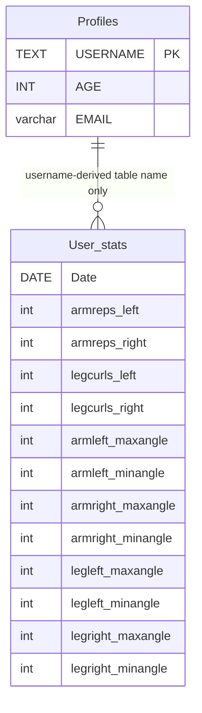
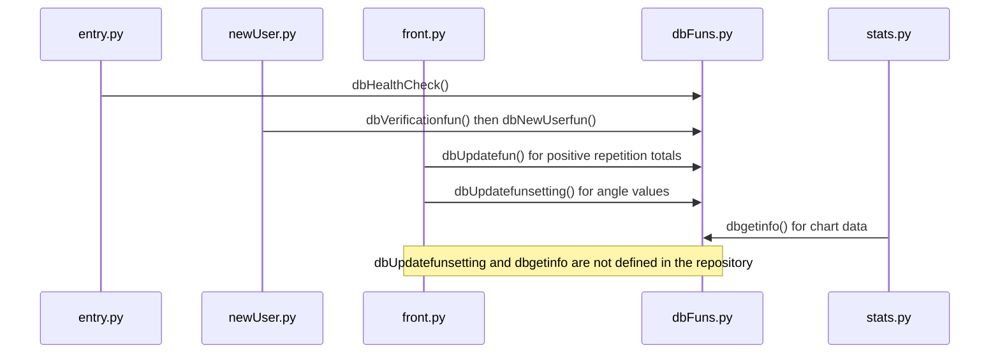

# SQLite Profiles, Workout Records, and Statistics

The desktop application in `noFrontEnd/` stores profile data and workout aggregates in SQLite through `noFrontEnd/dbFuns.py`. Its persistence model is simple and local, but the current call graph has important gaps: the UI calls two database functions that are not defined anywhere in the repository, and there is no migration or test suite covering this schema. Treat the behavior below as what the checked-in code implements—not as a guarantee that all workout statistics are successfully saved or loaded.

For application startup and the broader exercise lifecycle, see [Runtime Ownership](runtime-ownership.md), [Local Development](../operations/local-development.md), [Quickstart](../quickstart.md), and [Workout Session](../workflows/workout-session.md).

## Database location and setup

`dbFuns.py` captures `os.getcwd()` when the module is imported, then each function connects to `directory + '\\test.db'`. The database is therefore tied to the process working directory, not to the source file or a configured data directory. The literal backslash is a Windows path separator; on POSIX it is an ordinary filename character, so the resulting path may be an unexpected sibling-like filename rather than `test.db` inside the working directory. Launching from a different directory can also create or open a different database. There is no environment-variable or command-line override in the inspected code. See [Local Development](../operations/local-development.md) before changing launch directories or relocating data.

At import-time startup, `entry.py` calls `dbHealthCheck()`. This function queries `sqlite_master` for a table named `Profiles`; only if that table is absent does it create it with `USERNAME TEXT PRIMARY KEY NOT NULL`, `AGE INT`, and `EMAIL varchar(200)`, then commit. It does not validate or repair an existing table's columns, create existing users' missing stats tables, or perform versioned migrations. It returns no value, while `entry.py` tests it as `if not dbHealthCheck()`, so that condition is always true and the setup warning popup is shown even after the check runs. The popup does not stop execution.

## Tables and relationship

The diagram shows the logical relationship only: each newly created profile gets a separate table named `<username>_stats`; SQLite does not declare a foreign key between it and `Profiles`. The profile's username is a primary key, but a stats table has no declared primary key, uniqueness constraint on `Date`, or explicit indexes. Its `Date` plus twelve integer fields hold left/right arm-repetition counts, left/right leg-curl counts, and max/min angle values for each side of each exercise. The table is created by `dbNewUserfun`; it is not created lazily by the daily update function.

## Write and read call paths

The diagram distinguishes implemented functions from calls whose implementations are absent. In the session UI, after `repsfun` or `legscurlfun` returns, `frontdef` calls `dbUpdatefun` for left/right counts only when either count is positive. It then always calls `dbUpdatefunsetting` four times to store min/max angles. That name is not defined in `dbFuns.py` or elsewhere in the repository, so importing it with `from dbFuns import *` does not provide it; the first call raises `NameError` and prevents the remaining UI branch from completing. Stats UI similarly calls `dbgetinfo` to fetch dates, counts, and angles, but no implementation exists in the repository. Thus chart read behavior and angle persistence cannot be verified, and a stats-button click will encounter an undefined name. These are implementation gaps, not supported APIs; do not infer ordering, aggregation, or query semantics for them.

### Implemented write semantics

`dbUpdatefun(username, update_key, update_val)` opens a new SQLite connection and uses today's `date.today()` string as the daily key. It selects a matching date from `<username>_stats`; if a row is found it adds `update_val` to the selected field, otherwise it inserts a date plus twelve zeroes and then applies the increment. The function commits on either branch and closes the connection. It is an additive daily aggregate, not a per-repetition event log. Callers supply the field name: the active UI uses `armreps_left`, `armreps_right`, `legcurls_left`, and `legcurls_right`.

The two sides are written by two separate calls and therefore two separate connections and commits. A failure between them can leave one side updated and the other not; there is no encompassing workout transaction, rollback policy, or retry logic. The select-then-insert sequence is not protected by a unique date constraint or an explicit transaction spanning both statements, so concurrent updates can create duplicate daily rows. If duplicates already exist, the `SELECT` checks whether any row exists and the subsequent `UPDATE ... WHERE Date = ?` changes every matching row. Daily uniqueness and atomic workout consistency are therefore assumptions, not enforced invariants.

`dbNewUserfun` inserts the profile and creates the username-derived stats table on the same connection, then commits. This is the only checked-in path that creates a user's stats table. The user flow performs duplicate checks before invoking it, but those checks are separate from the insert; concurrent signup attempts can still collide on the username primary key. Exceptions are not handled at the UI or DB boundary, and the functions do not use `try/finally` or context managers to ensure connections are closed after failures.

## Profile lookup, local-data security, and change hazards

`dbVerificationfun(inp_val)` selects all profile rows and returns the email value from the first row containing `inp_val` in any of its fields. The login screen then compares that return value with the entered email. New-user validation also uses this same broad lookup for username and email existence checks. This is not a password-based authentication mechanism: the inspected code has no password storage or proof-of-identity challenge, and matching a profile email does not establish any stronger authentication guarantee. Age and email are stored locally in the SQLite file as ordinary SQLite values; the code does not encrypt or otherwise protect that file.

SQL values in profile insertions and the date/value portions of the daily update are parameterized, but SQL identifiers are interpolated from user-provided or caller-provided strings. The username is interpolated into the dynamic table name in both table creation and updates; `update_key` is interpolated as an SQL column/expression in `dbUpdatefun`. Quoting a dynamically assembled name with single quotes is not safe identifier binding and does not validate or escape it. The current UI accepts any nonempty username and does not restrict it to a safe identifier alphabet. This creates SQL syntax/injection and table-confusion risks and makes usernames part of the schema; adding escaping at a single call site is not a substitute for safely validating and quoting identifiers throughout. A safer change is to use fixed table names with username as a bound key, or to apply a rigorously validated identifier strategy and keep values parameterized.

`dbVerificationfun` returns from inside its row loop without closing its connection, and does not close it on the no-match path either. There is no explicit connection timeout, backup, corruption recovery, or database-file permission management in these functions. Health-check/setup failures and SQL errors are not converted into controlled persistence errors; callers should expect exceptions or a warning that currently does not reflect the check result.

## Verification and safe changes

There are no repository tests for this schema or persistence call path. Before changing table shape or daily-write semantics, inspect `noFrontEnd/dbFuns.py`, `noFrontEnd/front.py`, and `noFrontEnd/stats.py` together: the writes and reads must agree on field names and result shape, while `dbUpdatefunsetting` and `dbgetinfo` need actual implementations before their behavior can be tested. If adding migrations, account for existing `test.db` files and the per-user-table design rather than assuming startup recreates them. Focused tests should cover fresh setup, existing/incomplete schema behavior, profile creation and duplicate handling, one daily row with additive left/right totals, concurrent or repeated same-day writes, malformed identifiers, and the behavior of each supported chart query.
