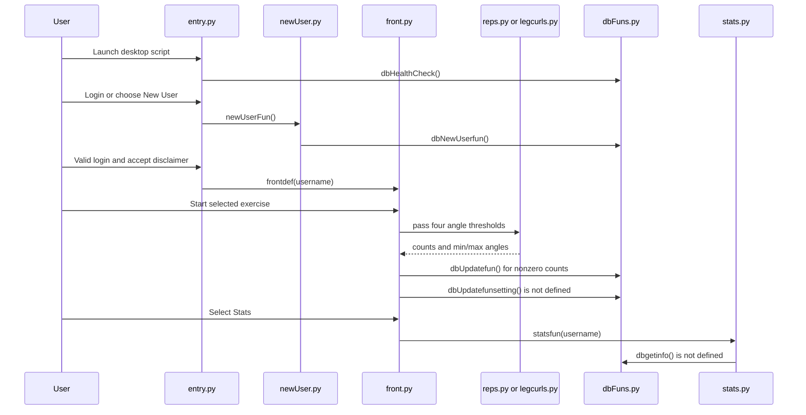

# Runtime Architecture and Ownership

## Runtime boundary

The repository contains a coherent **desktop GUI code path** under `noFrontEnd/`: `entry.py` constructs the login/setup flow, calls `frontdef` after login and disclaimer acceptance, and `front.py` dispatches the chosen exercise and statistics view. This is the most complete application path visible in the inspected source, not evidence of a deployed or currently operational application. In particular, the exercise-to-storage and statistics paths call functions that are not defined in the repository’s `dbFuns.py`, so the interface is wired more completely than its current end-to-end behavior. [Entry flow](../../noFrontEnd/entry.py) · [Workout UI](../../noFrontEnd/front.py) · [Persistence functions](../../noFrontEnd/dbFuns.py)

*The desktop call sequence is implemented across these modules; the two undefined persistence calls mark current failure points rather than working integrations.*

## Ownership by change area

| Change area | Owning path and responsibility | Boundary to keep in mind |
| --- | --- | --- |
| Login, account setup, and transition into workout selection | [`noFrontEnd/entry.py`](../../noFrontEnd/entry.py) owns the top-level PySimpleGUI event loop, basic name/email checks, login verification, disclaimer decision, and call to `frontdef`. [`noFrontEnd/newUser.py`](../../noFrontEnd/newUser.py) owns the Create/Cancel dialog, duplicate checks, email-format check, and account-creation call. | Account persistence is delegated to `dbFuns.py`. `entry.py` executes its logic at module load; it has no `if __name__ == '__main__'` guard. The repository does not document a launch command here. |
| Exercise choice and thresholds | [`noFrontEnd/front.py`](../../noFrontEnd/front.py) owns the setup window, exercise menu, four angle sliders, dispatch, result display, and opening statistics. | Slider defaults are 160° for stretch and 30° for fold on each side. The exercise modules receive those four values; a change to the dispatch/result contract must be coordinated with the selected exercise and persistence mapping. |
| Arm-repetition counting | [`noFrontEnd/reps.py`](../../noFrontEnd/reps.py) owns camera acquisition, MediaPipe pose processing, shoulder/elbow/wrist angles, per-side stage/counter state, on-screen overlay, and returned count/range values. [`noFrontEnd/yfunctions.py`](../../noFrontEnd/yfunctions.py) supplies the shared angle calculation used within this desktop package. | A side counts only after the angle first crosses its high threshold and then crosses its low threshold. The helper normalizes a three-point angle into the 0–180° range. |
| Leg-curl counting | [`noFrontEnd/legcurls.py`](../../noFrontEnd/legcurls.py) owns the analogous capture loop but measures ankle/knee/hip angles and tracks per-side `up`/`down` stages. | It shares the four-threshold interface and result shape with `repsfun`, but it is a separate exercise implementation; the counter stage labels are reversed relative to arm reps. |
| Local profile and daily exercise storage | [`noFrontEnd/dbFuns.py`](../../noFrontEnd/dbFuns.py) owns SQLite connection construction, profile creation/verification, account-table creation, and daily count increments. | `front.py` assumes additional settings-update functions that the module does not provide. Statistics reads are also expected by the UI but are not implemented in this storage module. See [Persistence](persistence.md) for the broader storage model. |
| Statistics window and plots | [`noFrontEnd/stats.py`](../../noFrontEnd/stats.py) owns the statistics UI and Matplotlib/Tk canvas rendering for arm reps and leg curls. | Each selection calls `dbgetinfo`, which has no definition in `noFrontEnd/dbFuns.py`; the chart path therefore cannot currently obtain its data through the checked-in persistence boundary. |

## Control flow, state, and current failures

1. **Startup and account flow.** Importing/running `entry.py` calls `dbHealthCheck()` before displaying the login window. Login requires nonempty name/email, validates email syntax, and compares the email returned for the entered name with the supplied email. New-user creation checks existing name and email, then calls `dbNewUserfun`. A successful login opens the disclaimer; `frontdef(username)` is reached only after the user selects Agree. Rejecting or closing the disclaimer does not call the workout UI. [Entry](../../noFrontEnd/entry.py) · [New user](../../noFrontEnd/newUser.py)
2. **Exercise session.** `frontdef` remains in its event loop while the setup window is open. Start dispatches to `repsfun` or `legscurlfun` based on the selected menu item. Both routines open camera device 0, process frames with MediaPipe Pose, update per-side stage/counter and observed angle extrema, display the feed, and stop on `q` or when capture is no longer open. They return `[right_count, left_count, left_min, right_min, left_max, right_max]`; when a side has no counted reps its returned minimum is set to zero. [Front](../../noFrontEnd/front.py) · [Arm reps](../../noFrontEnd/reps.py) · [Leg curls](../../noFrontEnd/legcurls.py)
3. **Persistence after Start is incomplete.** If either count is positive, `front.py` first calls `dbUpdatefun` to increment that exercise’s left/right daily totals. It then unconditionally calls `dbUpdatefunsetting` for four extrema, but `dbFuns.py` defines no such function. With the current imports, reaching this line raises `NameError` before the displayed result and popup later in the handler. A zero-rep session skips the count updates but still reaches the undefined settings call. [Front dispatch](../../noFrontEnd/front.py#L54-L85) · [Defined storage API](../../noFrontEnd/dbFuns.py#L9-L60)
4. **Statistics is likewise incomplete.** Selecting Stats opens `statsfun`, but clicking Armreps or Legcurls immediately calls `dbgetinfo`; no definition is present in the imported storage module or elsewhere in `noFrontEnd`. The chart creation/rendering code is present, but the data-query boundary it expects is not. [Stats UI](../../noFrontEnd/stats.py#L19-L100) · [Storage API](../../noFrontEnd/dbFuns.py#L9-L60)
5. **Startup checks do not report health as written.** `dbHealthCheck` creates the `Profiles` table if absent and closes the connection, but never returns a value. Since `entry.py` tests `if not dbHealthCheck()`, the “Database is not set up correctly” popup is shown on every execution of that check, even after the table exists; it does not stop the login loop. The check does not validate per-user stats tables. [Entry check](../../noFrontEnd/entry.py#L9-L12) · [Health check](../../noFrontEnd/dbFuns.py#L9-L21)
6. **Exit before successful login has an uninitialized-state failure.** `tempval` is assigned only in the successful-login branch, while the login loop can also break for other events. After the window closes, `if tempval` is evaluated regardless, so closing/exiting without a successful login can raise `UnboundLocalError`. [Login loop and post-loop branch](../../noFrontEnd/entry.py#L28-L47)

## Persistence and change invariants

`dbFuns.py` derives the database path once, at import time, from `os.getcwd()` plus the literal `\\test.db` suffix. All its operations use that path; the effective location therefore depends on the process working directory and the Windows-style separator construction. `dbHealthCheck` ensures only a `Profiles` table. Creating a profile inserts the username, age, and email and creates a username-specific `<username>_stats` table with a date, left/right arm and leg counts, and angle-extrema columns. The `dbUpdatefun` implementation uses the current date as the row key: it adds a count to an existing day row or inserts a zero-filled row and then adds the count. [Database setup and path](../../noFrontEnd/dbFuns.py#L1-L21) · [Daily increment and account schema](../../noFrontEnd/dbFuns.py#L33-L60)

When extending this boundary, keep account-table columns, exercise result ordering, the keys passed by `front.py`, and statistics query output aligned. The existing code currently violates that expected contract: extrema updates and reads are called by UI modules but missing from the storage API. Also account for pre-existing databases where `Profiles` exists but a user-specific stats table does not; the health check will not repair that state. The dynamic table and column identifiers in `dbFuns.py` are interpolated into SQL, so changes to account naming or update keys must be handled deliberately rather than treated as bound values.

## Adjacent artifacts are not the desktop runtime

- [`code/reps.py`](../../code/reps.py) is a separate camera/MediaPipe arm-repetition script with its own top-level capture loop and a `yfunctions` import local to `code/`. The desktop package uses its own `noFrontEnd/reps.py` and `noFrontEnd/yfunctions.py`; no call or import connecting the two paths is shown.
- [`code/armscurl.py`](../../code/armscurl.py) is another top-level camera experiment that processes pose and hand landmarks for visualization. It is not called by the desktop event path.
- [`code/index.html`](../../code/index.html) is an HTML dashboard template: it extends `layouts/base.html` and references a `getvid` URL and `data.calories` template value. Those template markers do not establish a connection to the PySimpleGUI application, and the inspected Python desktop modules do not serve this HTML. Treat the HTML and related files in `code/` as adjacent template/prototype assets, not as a second proven application runtime.
- [`LiteratureSurvey/readme.md`](../../LiteratureSurvey/readme.md) describes the folder as literature survey prerequisite material; it is not an executable module.

No deployment, web-serving integration, or sibling service is established by these paths. For related concerns see [Pose Counting](../concepts/pose-counting.md), [Runtime Dependencies](../integrations/runtime-dependencies.md), [Local Development](../operations/local-development.md), [Workout Session](../workflows/workout-session.md), and [Quickstart](../quickstart.md).

## Focused verification when changing this path

Validate changes against the actual boundaries rather than assuming the HTML assets or `/code` experiments cover them. Useful focused checks are:

- Exercise transition tests: high-threshold then low-threshold increments once per side; low-before-high does not count; left and right transitions remain independent. Verify the output list ordering and zero-count angle behavior consumed by `front.py`.
- Storage tests using a temporary SQLite database/path: profile creation and duplicate handling, daily same-date increments, creation of the per-user table, and behavior when a profile exists but its stats table is absent. Cover the return value expected by the startup health check.
- UI integration checks with camera and GUI dependencies stubbed: successful login/disclaimer transition, Start dispatch for both menu choices, and Stats data retrieval. Explicitly verify that every called persistence symbol is implemented and that the chart query returns the seven series consumed by `stats.py`.
