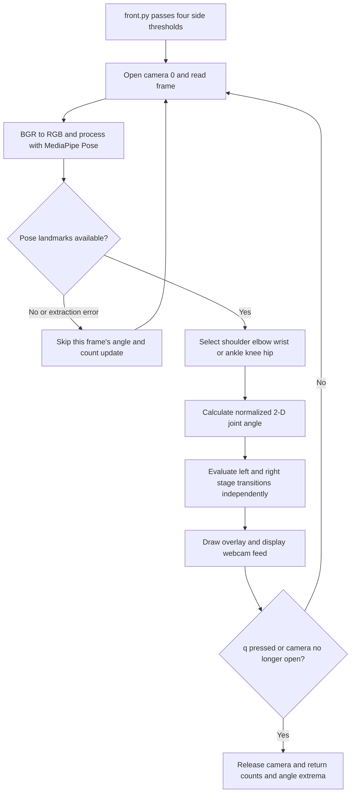

# Pose Angles and Exercise Rep Counting

The desktop counting path lives in `noFrontEnd/`: `repsfun` counts arm curls and `legscurlfun` counts leg curls. Each opens webcam device 0, runs MediaPipe Pose frame by frame, derives one 2-D joint angle per side, and increments a side-specific counter only after the configured high-angle and low-angle thresholds are crossed in sequence. These are simple geometric threshold state machines, not a learned exercise classifier or a smoothed motion detector. The desktop UI supplies the thresholds and consumes the returned counts and angle extrema. [Workout dispatch](../architecture/runtime-ownership.md#L48-L59)


*The diagram shows the implemented desktop pose-to-count loop; frame-read failures before pose extraction are not handled by the missing-pose skip path.*

## Runtime path and frame handling

`frontdef` in `noFrontEnd/front.py` invokes the exercise function selected in the UI and passes the four slider values in this order: left high/stretch, right high/stretch, left low/fold, right low/fold. The sliders range from 0° to 180° and default to 160° high and 30° low on each side. The exercise routines then own camera capture, pose processing, angle calculations, counters, overlays, and cleanup; the desktop UI later reads the result list. [UI configuration and dispatch](../../noFrontEnd/front.py#L21-L80)

Each exercise initializes independent left/right counters and `stage_* = None`, opens `cv2.VideoCapture(0)`, and creates a MediaPipe Pose context with detection and tracking confidence both set to `0.5`. Every loop reads a frame, converts OpenCV BGR to RGB, marks the image non-writeable for `pose.process`, then restores writeability and converts RGB back to BGR for drawing. The loops end on `q` or when `cap.isOpened()` becomes false; on normal exit they release the camera and destroy OpenCV windows. [Arm capture](../../noFrontEnd/reps.py#L12-L43) · [Leg capture](../../noFrontEnd/legcurls.py#L12-L43) · [Cleanup](../../noFrontEnd/reps.py#L169-L181)

The routines look up `results.pose_landmarks.landmark` inside a broad `try/except`. If the pose or required values are unavailable, the angle, stage, and count update for that frame is skipped, while existing per-side stage and count state remains in place. The exception is silently swallowed. However, `ret` from `cap.read()` is ignored and frame conversion happens before the guarded landmark block: an unsuccessful camera read can therefore fail before this missing-pose handling. There is no explicit frame-quality/visibility gate, angle smoothing, or debounce beyond the stage sequence. [Arm frame and exception handling](../../noFrontEnd/reps.py#L29-L47) · [Leg frame and exception handling](../../noFrontEnd/legcurls.py#L29-L44)

## Landmark geometry and shared helper

The arm routine selects each side's `SHOULDER`, `ELBOW`, and `WRIST`; the elbow is the vertex, so it calls `calculate_angle(shoulder, elbow, wrist)`. The leg-curl routine selects `ANKLE`, `KNEE`, and `HIP`; the knee is the vertex, so it calls `calculate_angle(ankle, knee, hip)`. Both pass only normalized landmark `x` and `y` coordinates to the helper; `z` and landmark visibility are not used by this calculation. [Arm landmarks and angles](../../noFrontEnd/reps.py#L45-L60) · [Leg landmarks and angles](../../noFrontEnd/legcurls.py#L43-L62)

`noFrontEnd/yfunctions.py::calculate_angle(a, b, c)` converts the three points to NumPy arrays, subtracts the two `atan2` directions from the middle point, takes the absolute degree value, and folds values above 180° via `360 - angle`. Its result is the smaller unsigned 2-D angle, in the 0–180° range; it has no exercise-specific thresholds. The same helper implementation is copied in `code/yfunctions.py`, but these are separate files, not one imported shared module across the two directories. [Desktop helper](../../noFrontEnd/yfunctions.py#L8-L19) · [Prototype helper](../../code/yfunctions.py#L8-L19)

## Independent stage machines and what counts

For arm reps, each side switches to `down` when its angle is strictly greater than that side's high threshold; it counts one rep and switches to `up` only when the angle is strictly below the low threshold while that side is already `down`. Leg curls use the reverse labels: `up` after a strict high-threshold crossing, followed by one counted rep and `down` after a strict low-threshold crossing. Equality with either threshold does not trigger that transition. A low-threshold crossing before the high crossing does not count, and after a count the side must cross high again before it can count another rep. Left and right stages/counters are independent. [Arm transitions](../../noFrontEnd/reps.py#L71-L88) · [Leg transitions](../../noFrontEnd/legcurls.py#L83-L99)

Both desktop routines track per-side minimum and maximum angles, updating extrema from rounded angle values. The displayed overlay reports each side's count and current rounded angle; leg curls also display stage and use colors based on whether the current angle lies between that side's thresholds. Angle extrema are returned for recording by the UI. [Arm extrema and overlay](../../noFrontEnd/reps.py#L61-L152) · [Leg extrema and overlay](../../noFrontEnd/legcurls.py#L61-L154)

### Return contract

When the capture loop ends normally, either exercise returns six values in this exact order:

```text
[right_count, left_count, left_min_angle, right_min_angle, left_max_angle, right_max_angle]
```

This order is easy to misread: the count slots are right then left, while the angle slots are left then right. If a side has zero counted reps, its returned minimum is forced to `0` even if angles were observed; its maximum remains the tracked maximum. The UI maps `res[1]` to left count and `res[0]` to right count, then maps the four extrema by their documented settings names. Keep this ordering coordinated if changing the return shape or adding a consumer. [Arm result construction](../../noFrontEnd/reps.py#L174-L181) · [Leg result construction](../../noFrontEnd/legcurls.py#L179-L186) · [UI result mapping](../../noFrontEnd/front.py#L57-L81)

The stage, counters, and extrema are local to one exercise invocation: starting a new session initializes them again. In the desktop UI, only positive counts cause the count-persistence calls, while the UI separately attempts to persist all four extrema. The actual setting-write function is absent from the repository, so angle persistence is not a working verified boundary; see [Runtime Ownership](../architecture/runtime-ownership.md#L57-L60) and [Persistence](../architecture/persistence.md#L52-L75).

## Prototype boundary and safe change plan

Do not treat the neighboring `/code` scripts as the desktop implementation. `code/reps.py` is a separate top-level webcam script: it uses fixed thresholds (`>160` and `<30`), counts both arms, and does not track or return angle extrema. `noFrontEnd/reps.py` is the UI-called routine with four configurable thresholds, extrema, and a six-value result. The adjacent `code/armscurl.py` is a separate pose/hand visualization loop, not the desktop exercise call path. [Desktop arm routine](../../noFrontEnd/reps.py#L7-L17) · [Prototype arm routine](../../code/reps.py#L9-L16) · [Prototype visualization](../../code/armscurl.py#L17-L24)

When changing the algorithm, preserve or intentionally coordinate these boundaries:

- Keep the landmark triplets and vertex order aligned with the intended joint, and keep normalized-coordinate assumptions consistent with any new angle or distance calculations.
- Treat threshold equality, strict comparison direction, stage labels, and per-side independence as observable counting behavior. If adjusting thresholds or adding hysteresis, update the UI controls/defaults and validate the sequence behavior for both exercises.
- Keep `repsfun` and `legscurlfun` result ordering synchronized with `front.py`'s persistence/result mappings. Consider a named result structure only as a coordinated contract change, not a local refactor.
- If extracting or changing the angle helper, account for both duplicated `yfunctions.py` copies; editing one does not update the other.
- Make capture failure handling explicit if changing frame acquisition. The current `ret` result is unused, and the broad landmark `except` can conceal pose extraction or downstream calculation errors rather than distinguishing expected missing landmarks from faults.

There are no focused tests in the inspected exercise modules. A useful focused test seam is to isolate angle calculation and the stage-transition logic from camera/UI code, then verify: representative straight/folded joint angles and the 0–180 normalization; high-then-low counts exactly once; low-before-high and threshold equality do not count; both sides transition independently; missed-pose frames do not mutate state; and the six-value return order/zero-count minima match the UI contract. For UI integration, stub camera, MediaPipe, and OpenCV rather than requiring a physical webcam. The existing counting routines do not currently expose these seams, so such tests would require extraction or controlled dependency stubs.

For application ownership and the downstream workout flow, see [Runtime Ownership](../architecture/runtime-ownership.md), [Workout Session](../workflows/workout-session.md), [Runtime Dependencies](../integrations/runtime-dependencies.md), and [Quickstart](../quickstart.md).
