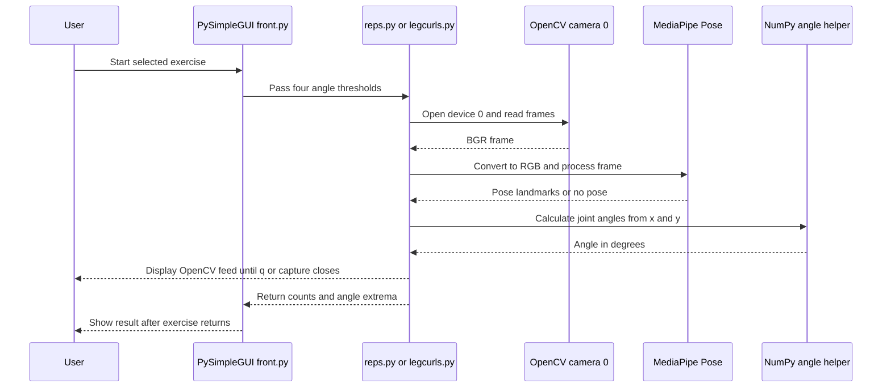

# Camera, Computer-Vision, and Desktop Dependencies

The application’s wired workout path is a local desktop integration: `noFrontEnd/front.py` calls a selected exercise synchronously; that exercise opens OpenCV camera device `0`, processes frames with MediaPipe Pose, and uses NumPy-backed angle math before returning counts and extrema. PySimpleGUI provides the windows, and Matplotlib embeds statistics charts in Tk canvases. These are in-process imports and local device/UI boundaries; the inspected code establishes no network or service integration. [Workout dispatch](../../noFrontEnd/front.py#L54-L85) · [Arm capture and processing](../../noFrontEnd/reps.py#L7-L60) · [Statistics rendering](../../noFrontEnd/stats.py#L1-L24)

*The sequence represents the synchronous desktop exercise path; camera and pose failures are not reported through a dedicated error/result contract.*

## Dependency declarations versus code usage

| Dependency or runtime | Used by application code | Declared/setup status |
| --- | --- | --- |
| OpenCV Python module (`cv2`) | `noFrontEnd/reps.py` and `legcurls.py` open a camera, convert and flip frames, draw overlays, and use `imshow`/`waitKey`; the `/code` experiments also import it. | `requirements.txt` contains `cv2` with no version. It does not document a distribution/install mapping or a supported OpenCV version. |
| MediaPipe (`mediapipe`) | Desktop exercises use `mp.solutions.pose.Pose`, pose landmark identifiers, and drawing utilities. | Declared as unpinned `mediapipe`; no runtime/model version is specified. |
| NumPy (`numpy`) | Desktop exercise code creates image arrays and scales landmark coordinates; `noFrontEnd/yfunctions.py` uses NumPy arrays and `arctan2` for joint-angle math. | Imported directly by application code but absent as a direct entry in `requirements.txt`. A transitive installation is not a declared direct dependency. |
| PySimpleGUI | `entry.py`, `front.py`, `newUser.py`, and `stats.py` build the application windows and event loops. | Used by the desktop application, but absent from `requirements.txt` and unpinned. |
| Tk / `tkinter` | PySimpleGUI uses the desktop GUI environment; Matplotlib’s `FigureCanvasTkAgg` embeds figures in the Tk canvases exposed by the GUI. | No Tk runtime/platform setup is documented or declared in `requirements.txt`; availability depends on the Python/OS environment. |
| Matplotlib | `noFrontEnd/stats.py` creates line plots, and `FigureCanvasTkAgg` renders them in the statistics window. `front.py` also imports plotting/canvas helpers. | Used and imported but absent from `requirements.txt` and unpinned. |

The complete checked-in requirements file has only the two unversioned entries `mediapipe` and `cv2`; it therefore does not describe all directly imported packages or establish a reproducible compatible environment. In particular, the code’s import name `cv2` is not itself evidence of which installable OpenCV distribution the project expects. There is no dependency lockfile or version matrix in the inspected setup material. [Requirements](../../requirements.txt#L1-L2) · [Exercise imports](../../noFrontEnd/reps.py#L1-L4) · [Angle helper](../../noFrontEnd/yfunctions.py#L1-L19) · [GUI and plot imports](../../noFrontEnd/front.py#L1-L8) · [Statistics imports](../../noFrontEnd/stats.py#L1-L6)

For environment setup, treat these as gaps to resolve rather than assuming that installing only `requirements.txt` supplies the desktop runtime. Confirm supported Python, OpenCV, MediaPipe, NumPy, PySimpleGUI, Matplotlib, and Tk combinations on the target OS before pinning or changing versions. The repository contains no automated camera/GUI integration tests or documented hardware-independent setup contract; the exercise loops need a camera and OpenCV display for normal interactive use.

## Camera-to-pose call and lifecycle

When the user selects Start in `frontdef`, the main PySimpleGUI event handler invokes `repsfun` or `legscurlfun` directly, passing the two high and two low angle thresholds. The handler remains inside the exercise call while its OpenCV loop runs; its result handling and the next GUI event occur only after the exercise returns. Both routines construct `cv2.VideoCapture(0)` internally, so the device index is fixed rather than supplied through UI or configuration. [Start dispatch](../../noFrontEnd/front.py#L54-L85) · [Arm acquisition](../../noFrontEnd/reps.py#L7-L30) · [Leg acquisition](../../noFrontEnd/legcurls.py#L7-L31)

For each successful iteration, the routines convert the BGR frame to RGB, set image writeability false around `pose.process(image)`, restore writeability, and use MediaPipe’s returned landmarks for the exercise’s left/right joint points. Arm reps use shoulder–elbow–wrist points; leg curls use ankle–knee–hip points. The selected `x` and `y` coordinates go to `calculate_angle`, which forms the unsigned smaller 2-D angle in degrees within 0–180. The routines then update their local stage/counter/extrema state and draw/display the feed. [Arm frame flow](../../noFrontEnd/reps.py#L28-L60) · [Leg frame flow](../../noFrontEnd/legcurls.py#L29-L62) · [Angle math](../../noFrontEnd/yfunctions.py#L8-L19)

Each call creates a MediaPipe Pose context with detection and tracking confidence set to `0.5`. The loop condition is `cap.isOpened()`; while it remains true, `cv2.waitKey(10)` checks for `q`. After ordinary loop completion, both implementations call `cap.release()` and `cv2.destroyAllWindows()`; leaving the `with mp_pose.Pose(...)` block also closes the Pose context. A new exercise invocation creates fresh counters, stages, and extrema. [Arm lifecycle](../../noFrontEnd/reps.py#L12-L30) · [Arm exit and results](../../noFrontEnd/reps.py#L159-L181) · [Leg exit and results](../../noFrontEnd/legcurls.py#L163-L186)

This cleanup is not protected by `try/finally`: an exception escaping the loop can bypass the explicit camera release and window destruction, although the Pose context manager still exits as stack unwinds. In particular, the return value `ret` from `cap.read()` is ignored and frame conversion happens immediately. A failed read can thus raise during conversion before the landmark exception handler, so the missing-landmark fallback does not make capture failures safe. Conversely, if the camera is not open at loop entry, the loop can be skipped and the routine proceeds to cleanup and a zero-count result rather than displaying a camera-specific error. [Arm read/guard/cleanup](../../noFrontEnd/reps.py#L28-L47) · [Leg read/guard/cleanup](../../noFrontEnd/legcurls.py#L29-L44) · [Loop exit](../../noFrontEnd/legcurls.py#L169-L186)

Pose lookup and angle updates are under broad, silent `except` blocks. Missing landmarks therefore skip angle/state updates for that frame, but do not surface a diagnostic or distinguish expected no-pose frames from other exceptions in the guarded work. `ret`/frame conversion are outside that guard, as are subsequent drawing/display operations. Camera permission, absent/busy device, invalid frame, MediaPipe initialization/model/runtime incompatibility, GUI display availability, and abrupt loop exceptions have no explicit recovery or user-facing error mapping in these routines. [Arm guarded landmark processing](../../noFrontEnd/reps.py#L45-L99) · [Leg guarded landmark processing](../../noFrontEnd/legcurls.py#L43-L107)

## Desktop windows, charts, and resource ownership

`entry.py` owns the top-level PySimpleGUI login flow and calls `frontdef` after a successful login and disclaimer agreement. `front.py` owns the workout setup window and dispatches exercise work from its event loop. The Start event runs capture synchronously rather than in a worker, so the setup event loop does not process another event until the exercise call exits. The exercise’s `q` check is through the OpenCV window, not a PySimpleGUI event. [Entry flow](../../noFrontEnd/entry.py#L25-L69) · [Workout event loop](../../noFrontEnd/front.py#L21-L85) · [OpenCV quit check](../../noFrontEnd/reps.py#L159-L173)

Statistics are a separate PySimpleGUI window in `statsfun`. On an Armreps or Legcurls click, it requests series from `dbgetinfo`, constructs Matplotlib figures, embeds them into Tk canvases with `FigureCanvasTkAgg`, and replaces earlier canvas widgets when another selection is plotted. `delete_figure_agg` forgets the widget and calls `plt.close('all')`; exiting the statistics loop closes the window. This documents the intended plotting integration, not a complete working data path: `dbgetinfo` is not defined in the checked-in `noFrontEnd/dbFuns.py`, as described in [Runtime Ownership](../architecture/runtime-ownership.md#L53-L60). [Stats event and charts](../../noFrontEnd/stats.py#L19-L100) · [Tk canvas helper](../../noFrontEnd/stats.py#L9-L17)

The UI and exercise modules also depend on native desktop capabilities beyond pip imports: camera device access, OpenCV GUI windows, and a functioning Tk display. A headless environment, missing camera permission/device, or unavailable Tk/display can fail independently of Python package import success. The source does not define a headless mode, camera selector, device retry, or alternative GUI backend.

## Failure triage and change boundaries

| Symptom | Likely boundary and behavior |
| --- | --- |
| Dependency import error on application startup | Compare imports in `noFrontEnd/entry.py`, `front.py`, exercise modules, and `stats.py` with the sparse `requirements.txt`; GUI, plotting, and NumPy imports are not all declared. |
| Exercise immediately ends with zero counts | Device `0` may not have opened, causing the `cap.isOpened()` loop to be skipped; code does not report that as a camera error. |
| Frame conversion error or abrupt exit while starting exercise | `cap.read()` success is unchecked before `cv2.cvtColor`; the returned `ret` is unused and explicit camera/window cleanup is not in `finally`. |
| Feed runs but no reps increment | No pose landmarks or failed guarded landmark/angle processing is silently skipped; counting also requires the configured high-then-low threshold sequence. See [Pose Counting](../concepts/pose-counting.md). |
| GUI or chart cannot open/render | Check PySimpleGUI, Matplotlib, Tk availability and display support; chart rendering also calls the currently missing `dbgetinfo` storage function. |
| Camera or model initialization fails | `VideoCapture(0)` and MediaPipe Pose use local defaults; there is no configured alternate device, model path, retry, or explicit diagnostic branch in the desktop routines. |

Keep the integration boundary explicit if extending it: expose camera selection and report capture-open/read failures as distinct outcomes; ensure cleanup is guaranteed for exceptional exits; decide how no-pose frames differ from processing errors; and keep the installed/package version set aligned across OpenCV, MediaPipe, NumPy, GUI/Tk, and Matplotlib. Refactors of the exercise call also need to preserve the four-threshold input and six-item return contract consumed by `front.py`. [UI exercise contract](../../noFrontEnd/front.py#L54-L81) · [Exercise return construction](../../noFrontEnd/reps.py#L174-L181) · [Pose/count contract](../concepts/pose-counting.md)

The related `/code` camera scripts are separate experiments, not alternate desktop dependencies wired into the workout path: `code/armscurl.py` uses OpenCV, MediaPipe Pose and Hands, and NumPy at module execution; `code/reps.py` also has a top-level camera loop. Do not infer their lifecycle or dependencies are exercised by `noFrontEnd` entrypoint. [Adjacent visualization](../../code/armscurl.py#L1-L24) · [Adjacent reps script](../../code/reps.py#L1-L23) · [Desktop ownership](../architecture/runtime-ownership.md#L70-L74)

## Verification focus

No focused automated tests for these camera, pose, or desktop-GUI integrations were found in the repository. To verify changes without depending on physical hardware, add or use seams that can stub `VideoCapture`, frame reads, `Pose.process`, drawing, `waitKey`, and GUI event loops. Cover camera-open false, failed frame reads, missing landmarks, normal `q` exit, exceptions during frame processing, and cleanup of capture/windows/Pose. For desktop wiring, stub the exercise result and validate the GUI’s threshold arguments and result mapping; test plot construction separately from the currently missing statistics data function. These are recommended checks, not tests currently present. [Arm loop](../../noFrontEnd/reps.py#L28-L181) · [Leg loop](../../noFrontEnd/legcurls.py#L29-L186) · [Front dispatch](../../noFrontEnd/front.py#L54-L85) · [Stats data/render path](../../noFrontEnd/stats.py#L33-L100)

See [Pose Counting](../concepts/pose-counting.md) for angle and repetition behavior, [Runtime Ownership](../architecture/runtime-ownership.md) for the wired desktop path, and [Local Development](../operations/local-development.md) and [Quickstart](../quickstart.md) for broader setup and launch guidance.
