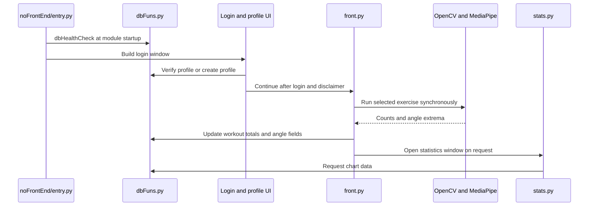

# Local Setup, Runtime Diagnostics, and Validation

The runnable workout application is the desktop program under `noFrontEnd/`; `noFrontEnd/entry.py` is its apparent entry module. It imports the login, exercise, database, and GUI modules at module load, checks the database, then opens the login flow. A successful login followed by agreement with the disclaimer enters the workout setup UI. The README only identifies the project as a computer-vision workout capstone; it does not document a launch command, installation procedure, supported Python version, or supported operating systems. Do not treat a command or platform combination as a repository-verified setup contract. See [Runtime Ownership](../architecture/runtime-ownership.md), [Runtime Dependencies](../integrations/runtime-dependencies.md), [Persistence](../architecture/persistence.md), and [Quickstart](../quickstart.md).

*The diagram follows the wired desktop flow; the angle-write and chart-read function calls shown are present in callers, but their implementations are absent from the repository.*

## Setup prerequisites and launch boundaries

- `requirements.txt` contains only unpinned `mediapipe` and `cv2`. The application also imports `PySimpleGUI`, `numpy`, and `matplotlib`; those packages are not listed as direct requirements. `cv2` is an import name, not documentation of a distribution/install command. Tk is used by the GUI and Matplotlib's `FigureCanvasTkAgg`, but no Tk setup is documented. Dependency installation alone therefore cannot be assumed to provide a complete or compatible desktop runtime. The repository provides no lockfile or version matrix. [Requirements](../../requirements.txt#L1-L2) · [Login imports](../../noFrontEnd/entry.py#L1-L7) · [Exercise imports](../../noFrontEnd/reps.py#L1-L4) · [Statistics imports](../../noFrontEnd/stats.py#L1-L6)
- The imports between files in `noFrontEnd/` are bare module imports (`from reps ...`, `from dbFuns ...`), not package-qualified imports. The source establishes `entry.py` as the UI entry module but does not prescribe how it must be invoked or packaged. Keep the `noFrontEnd` module directory available for those imports when choosing a launch arrangement; verify it in the intended environment rather than assuming a packaged executable or installable project.
- The app needs a functioning desktop GUI/Tk display for PySimpleGUI windows and chart embedding. Exercise routines additionally rely on OpenCV's camera capture and display APIs and MediaPipe Pose. The code selects camera device index `0`; it exposes no camera selector or headless mode. It does not establish a supported OS, camera model, or hardware matrix. [Exercise loop](../../noFrontEnd/reps.py#L7-L30) · [GUI/chart integration](../../noFrontEnd/stats.py#L1-L17)
- `code/funtioning.py` is not the desktop entry path: it imports pandas, reads `datasetoutput.csv` relative to the current working directory, and writes to a hard-coded Windows path. It is a separate data script and is not covered by the two entries in `requirements.txt`. [Script](../../code/funtioning.py#L1-L12)

## Diagnostic map

| Observable symptom | Source-grounded boundary and diagnostic direction |
| --- | --- |
| `ModuleNotFoundError` during startup | Imports run at module load in `entry.py` and its imports, including PySimpleGUI, OpenCV, MediaPipe, NumPy, and Matplotlib in downstream modules. Compare the active environment with these imports; only `mediapipe` and `cv2` appear in the requirements file. The repository does not identify a tested set of package versions. [Imports](../../noFrontEnd/entry.py#L1-L7) · [Requirements](../../requirements.txt#L1-L2) |
| Startup displays “Database is not set up correctly” even when setup succeeded | `dbHealthCheck()` returns no value. `entry.py` tests `if not dbHealthCheck()`, so the condition is true after the check and the popup is unconditional; it does not prove setup failed. The check only creates `Profiles` if that table is missing and does not validate columns in an existing table. [Startup check](../../noFrontEnd/entry.py#L9-L11) · [Health check](../../noFrontEnd/dbFuns.py#L9-L20) |
| A different or unexpected SQLite file appears, or a profile/table is missing | `dbFuns.py` captures `os.getcwd()` when imported and builds the file path as `directory + '\\test.db'` for connections. There is no configured data-directory override. The health check creates `Profiles` only; each per-user `<username>_stats` table is created during new-user creation, not repaired at startup for existing profiles. Check the process working directory and the profile/table lifecycle before assuming the database is corrupt. [Path and check](../../noFrontEnd/dbFuns.py#L5-L20) · [New-user schema](../../noFrontEnd/dbFuns.py#L52-L60) |
| Exercise immediately returns with zero counts, or crashes on startup | Both exercise implementations create `VideoCapture(0)` and enter the loop only if `cap.isOpened()`; an unopened camera can therefore skip processing without a camera-specific message. Each loop ignores the success flag from `cap.read()` and converts the returned frame immediately, so a failed read can fail before pose handling. Camera release and window destruction occur after the loop, not in `finally`. [Arm capture/cleanup](../../noFrontEnd/reps.py#L12-L42) · [Leg capture/cleanup](../../noFrontEnd/legcurls.py#L12-L44) |
| Camera feed appears but counts do not change | Landmark access, angle calculation, and state updates are inside broad, silent exception handlers. No landmarks or another error in that guarded section can skip the current frame without a diagnostic. Counts also require crossing the configured high and low thresholds in sequence. Frame capture and later drawing/display work are outside that guarded section. [Arm processing](../../noFrontEnd/reps.py#L45-L99) · [Leg processing](../../noFrontEnd/legcurls.py#L43-L107) |
| GUI or statistics window does not open or charts fail | GUI construction uses PySimpleGUI; statistics embeds Matplotlib figures through Tk's `FigureCanvasTkAgg`. Check package imports and desktop/Tk display availability independently. On selecting a chart, `stats.py` calls `dbgetinfo`, but no definition of that function exists in the repository, so a chart request reaches an undefined name. [GUI/chart code](../../noFrontEnd/stats.py#L19-L100) |
| Workout result displays but persistence fails after exercise | `frontdef` calls implemented `dbUpdatefun` for nonzero repetition counts, then calls `dbUpdatefunsetting` to store angle values. There is no `dbUpdatefunsetting` definition in the repository; the first such call raises `NameError`, so the remaining result handling can be interrupted. The implemented daily-count update also requires the user's stats table to exist. [Workout write calls](../../noFrontEnd/front.py#L54-L81) · [Implemented DB functions](../../noFrontEnd/dbFuns.py#L33-L60) |

For the database's path, schema, and write semantics, use [Persistence](../architecture/persistence.md). For camera lifecycle and GUI dependency boundaries, use [Runtime Dependencies](../integrations/runtime-dependencies.md). The workout control thresholds and frame-to-count behavior are described in [Workout Session](../workflows/workout-session.md).

## Validation and evidence limits

No automated test files or test configuration were found in the repository tree. There are no checked-in camera/GUI integration tests or documented hardware-independent test seams. The recommendations below are validation targets, not commands or tests that already exist:

- For a database change, verify fresh `Profiles` creation, behavior with an existing/incomplete schema, new-user stats-table creation, and repeated same-day count updates. Keep the caller and schema field names aligned. The current startup check is not a migration or schema validator.
- For exercise changes, isolate or stub camera reads, pose results, and display events where practical. Check unopened capture, failed reads, absent landmarks, threshold transitions, normal `q` exit, and cleanup on exceptional exits. The current loops provide no explicit diagnostic contract for these failures.
- For GUI/statistics changes, test UI wiring separately from data access. Chart loading cannot be fully exercised against repository code until `dbgetinfo` has an implementation; angle persistence likewise cannot be verified until `dbUpdatefunsetting` exists.

The setup and deployment evidence is intentionally limited: `README.md` gives a project description only, and the inspected repository has no packaging metadata, dependency lock/version specification, automated test suite, or deployment instructions. It also defines no supported OS/Python/camera matrix. Those details are unknown, not implied by the presence of a local GUI or by the listed dependencies. [README](../../README.md#L1-L9) · [Requirements](../../requirements.txt#L1-L2)
