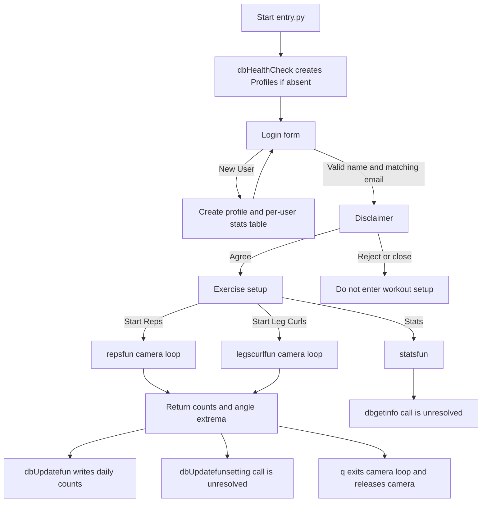

# Login-to-Workout and Statistics Workflow

This page describes the desktop workflow implemented by `noFrontEnd/entry.py`, `front.py`, the exercise modules, and `dbFuns.py`. The intended journey is login or account creation → accept the disclaimer → choose an exercise and thresholds → run a camera session → persist results → view statistics. That journey is only partially operational: several calls made by the interface do not exist in the repository, and there are startup and camera failure paths described below. There are no test files in the repository to treat as behavioral confirmation.

## Workflow at a glance

*The diagram summarizes the intended route and the present persistence/statistics call gaps; the entry/login transitions are in `entry.py`, setup dispatch in `front.py`, camera loops and return values in the exercise modules, and database calls in `dbFuns.py`.* ([`entry.py`](../../noFrontEnd/entry.py#L9-L69), [`front.py`](../../noFrontEnd/front.py#L21-L125), [`reps.py`](../../noFrontEnd/reps.py#L7-L181), [`legcurls.py`](../../noFrontEnd/legcurls.py#L7-L186), [`dbFuns.py`](../../noFrontEnd/dbFuns.py#L9-L60), [`stats.py`](../../noFrontEnd/stats.py#L19-L100))

## Initialization, login, and account creation

At import/startup, `entry.py` calls `dbHealthCheck()`. That function opens `test.db` using `os.getcwd() + '\\test.db'`, checks SQLite's table catalog, creates `Profiles` if it is absent, then closes the connection. It has no explicit return value, so it returns `None`; consequently `if not dbHealthCheck()` is true on every normal call and the “Database is not set up correctly” popup is shown even after a successful health check. The condition does not establish that the database is unhealthy. The database path is working-directory-relative and uses a backslash, so its actual path behavior depends on the host platform and current working directory. ([`entry.py`](../../noFrontEnd/entry.py#L9-L12), [`dbFuns.py`](../../noFrontEnd/dbFuns.py#L5-L20))

The login form rejects blank name/email and checks the email against a regular expression. It then calls `dbVerificationfun(name)` and compares the returned email with the entered email. `dbVerificationfun` scans all `Profiles` rows and, if the supplied value occurs in any row, returns that row's email field; it does not distinguish a username match from an email match. Thus the login check is a name-to-stored-email comparison, not password authentication. A successful match saves the username as `tempval`, closes the login window, and opens the disclaimer. ([`entry.py`](../../noFrontEnd/entry.py#L13-L46), [`dbFuns.py`](../../noFrontEnd/dbFuns.py#L23-L30))

Choosing **New User** opens a separate form. Creation checks for an existing username and email via the same row-scanning function, then rejects a blank username/email or a malformed email. It does not validate the age field or require it to be nonempty before passing it to `dbNewUserfun`. That function inserts the profile and creates a username-specific `<username>_stats` table with a date column, bilateral repetition columns, and angle-extrema columns. On success the form reports that the account was created and returns to the login form; the new user must log in separately. Duplicate names, invalid input, and SQLite failures are not caught around the insert/table creation, so database constraint or SQL errors can interrupt account creation. ([`newUser.py`](../../noFrontEnd/newUser.py#L7-L44), [`dbFuns.py`](../../noFrontEnd/dbFuns.py#L52-L60))

One exit path is a concrete bug: `tempval` is assigned only after a successful login, but after the login window closes `entry.py` always evaluates `if tempval`. Exiting or closing the login window without first logging in can therefore raise `NameError` instead of returning cleanly. ([`entry.py`](../../noFrontEnd/entry.py#L28-L47))

## Disclaimer and exercise setup

After a valid login, the disclaimer offers **Agree** and **Reject**. Only **Agree** sets the flag, closes the disclaimer window, and calls `frontdef(tempval)`. Rejection or closing the window leaves the flag false and bypasses workout setup; the rejection branch does not explicitly close the disclaimer window. This is an in-session gate, not a persisted acceptance record. ([`entry.py`](../../noFrontEnd/entry.py#L47-L69))

`frontdef` displays **Reps** and **Leg Curls**, four slider thresholds, and **Set**, **Start**, **Stats**, and **Exit** controls. **Set** only copies slider values into display labels; the current slider values are passed to the exercise when **Start** is clicked. Starting without selecting one of the two exercises displays a selection prompt. **Exit** or closing the setup window leaves the loop and closes the window. ([`front.py`](../../noFrontEnd/front.py#L21-L54), [`front.py`](../../noFrontEnd/front.py#L83-L85), [`front.py`](../../noFrontEnd/front.py#L123-L125))

## Camera session, result shape, and persistence

Both exercise functions open camera index `0`, initialize independent left/right counters and angle extrema, and process frames in a MediaPipe Pose context until the capture is no longer open or the user presses `q`. Reps derives elbow angles from shoulder/elbow/wrist landmarks; leg curls derives knee angles from ankle/knee/hip landmarks. The supplied upper and lower thresholds control a two-stage transition for each side, and each completed transition increments that side's counter. On `q`, the loop breaks and the function releases the capture and destroys OpenCV windows before returning. Both functions return `[right_count, left_count, left_min_angle, right_min_angle, left_max_angle, right_max_angle]`; if a side has no counted repetition its returned minimum is set to zero. ([`reps.py`](../../noFrontEnd/reps.py#L7-L29), [`reps.py`](../../noFrontEnd/reps.py#L45-L88), [`reps.py`](../../noFrontEnd/reps.py#L169-L181), [`legcurls.py`](../../noFrontEnd/legcurls.py#L7-L36), [`legcurls.py`](../../noFrontEnd/legcurls.py#L43-L99), [`legcurls.py`](../../noFrontEnd/legcurls.py#L174-L186))

The frame-read success flag is assigned but never checked before `cv2.cvtColor(frame, ...)`. If a camera is considered open but a read fails, conversion can fail before the cleanup statements, and that failure is not covered by the landmark-processing `try` block. The broad `try/except` inside each loop only suppresses exceptions in its landmark/counting section; it does not make camera acquisition or the whole workout failure-safe. If the camera is not open initially, the loop is skipped and the function returns zero counts and default extrema. No explicit camera-open error is reported to the user. ([`reps.py`](../../noFrontEnd/reps.py#L12-L13), [`reps.py`](../../noFrontEnd/reps.py#L28-L46), [`reps.py`](../../noFrontEnd/reps.py#L91-L92), [`reps.py`](../../noFrontEnd/reps.py#L169-L181), [`legcurls.py`](../../noFrontEnd/legcurls.py#L13-L14), [`legcurls.py`](../../noFrontEnd/legcurls.py#L29-L44), [`legcurls.py`](../../noFrontEnd/legcurls.py#L156-L158), [`legcurls.py`](../../noFrontEnd/legcurls.py#L174-L186))

When the exercise function returns, `frontdef` writes counts only if either count is positive. `dbUpdatefun` looks for today's row in the user's stats table, adds the supplied count to the matching exercise column when found, or inserts a zero-filled daily row and then adds the count when absent. The database stores one row per workout date in practice because lookup and update are date-based, though the table definition does not declare `Date` unique. The UI's result display maps `res[1]` to left and `res[0]` to right. ([`front.py`](../../noFrontEnd/front.py#L57-L81), [`dbFuns.py`](../../noFrontEnd/dbFuns.py#L33-L49), [`dbFuns.py`](../../noFrontEnd/dbFuns.py#L57-L59))

After that, both exercise branches call `dbUpdatefunsetting` four times to record the returned left/right minimum and maximum angles. No such function is defined anywhere in the repository: `dbFuns.py` defines `dbUpdatefun` and `dbNewUserfun`, but not `dbUpdatefunsetting`. Therefore a returned workout reaches the count writes first and then raises `NameError` at the first angle-setting call. Positive counts may already have been committed by `dbUpdatefun`; the success result text and popup that follow the missing calls are not reached. If there were zero counts, the angle call still happens and fails. Consequently the implemented database path currently persists repetition counts but does not successfully finish the workout UI or persist angles. ([`front.py`](../../noFrontEnd/front.py#L59-L68), [`front.py`](../../noFrontEnd/front.py#L72-L81), [`dbFuns.py`](../../noFrontEnd/dbFuns.py#L33-L49), [`dbFuns.py`](../../noFrontEnd/dbFuns.py#L52-L60))

## Statistics rendering and return to setup

The **Stats** button calls `statsfun(vname)`. Its window offers **Armreps** and **Legcurls** and two canvases. Selecting either invokes `dbgetinfo(vname, exercise)` for the date series, left/right counts, and four angle series, then plots counts and angle extrema with Matplotlib and embeds figures in the canvases. Repeated selections remove the previous canvas widgets and close the prior figures; closing the statistics window returns from `statsfun` to the setup event loop. ([`front.py`](../../noFrontEnd/front.py#L86-L123), [`stats.py`](../../noFrontEnd/stats.py#L19-L36), [`stats.py`](../../noFrontEnd/stats.py#L37-L67), [`stats.py`](../../noFrontEnd/stats.py#L68-L100))

However, `dbgetinfo` is also absent from the repository. A selection therefore raises `NameError` before plotting, so the described graphs are intended behavior rather than a functioning statistics path. The prior commented-out statistics implementation in `front.py` is not active. ([`stats.py`](../../noFrontEnd/stats.py#L37-L40), [`stats.py`](../../noFrontEnd/stats.py#L68-L70), [`front.py`](../../noFrontEnd/front.py#L86-L123))

## Change and test implications

To complete the journey safely, the missing database interfaces must be implemented or the callers changed in coordination: angle persistence must target the existing per-user angle columns, and statistics retrieval must return the seven parallel series consumed by `statsfun`. Ensure those operations commit/close connections and define behavior for dates with no workout. Separately, initialize the login state before the event loop, make health-check status explicit, handle camera open/read failures with cleanup, and decide whether disclaimer acceptance should survive application restarts. These are extension requirements inferred from current call sites and failures, not implemented behavior.

No tests were found in the repository. Focused tests that would matter include database initialization return semantics and schema, new-user/login validation, per-day counter accumulation, left/right result-to-column mapping, no-repetition angle values, missing camera/frame cleanup, the login-exit path, and statistics query/series handling. Exercise these database/UI boundaries with camera and GUI calls isolated or mocked; do not treat the workflow as verified until these cases are covered.
