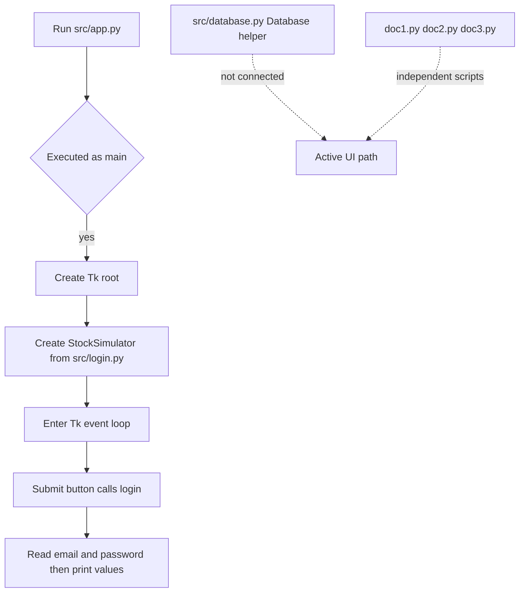

# System Architecture and Ownership

## Active application boundary

The maintained application path in `src/` is deliberately small: `src/app.py` creates the Tkinter root window, instantiates `StockSimulator` from `src/login.py`, then runs Tk's event loop. The login module owns the screen and its button callback. `src/database.py` is a separate PostgreSQL helper; nothing in the active `app.py` or `login.py` imports or invokes it. The root-level `doc1.py`, `doc2.py`, and `doc3.py` are separate prototype programs, not active application modules.

*The diagram shows the checked-in active UI startup path and its boundaries; the database helper and root prototypes are not part of that path.*

### Entrypoint and UI responsibilities

- [src/app.py](../../src/app.py) is the active launcher. Its `__main__` block creates `Tk()`, passes that root into `StockSimulator`, and calls `root.mainloop()`. It imports the UI class using `from login import StockSimulator`, relying on the `src` directory being on Python's import path when the script is launched directly (for example, from `src/` as described in [src/README.md](../../src/README.md)).
- [src/login.py](../../src/login.py) owns the `StockSimulator` UI. Construction sets the window title and appearance and creates a login frame with email and password entries; the password entry is masked. Submitting invokes `login()`, which reads both entry values and prints them. The callback has a comment placeholder for login logic, but does not authenticate, query PostgreSQL, or transition to another application screen.
- `src/login.py` also has its own `__main__` block that can create a Tk root and run the UI directly. This is an alternate way to display the same stub login screen, not a separate authenticated workflow.

### Database helper and integration boundary

[src/database.py](../../src/database.py) defines `Database`, a small direct `psycopg2` wrapper. Its constructor connects immediately using supplied credentials and defaults of host `127.0.0.1`, port `5432`, and database `stocksdb2`, and stores one connection and cursor on the instance. `execute_query(query, params=None)` executes on that cursor and commits; `fetch_all()` returns the cursor's current `fetchall()` result; `close()` closes both cursor and connection. Callers are expected to execute before fetching and to close the instance when finished.

This class is not the persistence layer of the active UI today: neither `app.py` nor `login.py` imports `Database`, and the login callback only prints entered values. The helper has no connection to the UI's input lifecycle, no automatic cleanup context, and no exception handling around connect, execute, commit, fetch, or close. In particular, the constructor can fail before an instance exists if PostgreSQL is unavailable or the credentials/database are invalid. The source README describes the project dependencies as Python 3, `psycopg2`, and `tkinter`; launching the active path also imports `psycopg2` at module load through `login.py`, even though the login callback does not use it.

For actual PostgreSQL operation notes, see [PostgreSQL integration](../integrations/postgresql.md) and [Local runtime](../operations/local-runtime.md). The behavior described there should not be read as evidence that login or trading is wired into the active UI.

### Root-level scripts are prototypes, not active features

The files [doc1.py](../../doc1.py), [doc2.py](../../doc2.py), and [doc3.py](../../doc3.py) are independent Tkinter scripts with their own root-window setup and event loops. No active `src/` module imports them, and `src/app.py` does not dispatch to them. Their source contains examples of database browsing and trading/account workflows, but those capabilities are not available through the active app described above.

At a high level, `doc1.py` is a basic table-viewing prototype with credential-based PostgreSQL connections and displays. `doc2.py` and `doc3.py` are larger, distinct trading/account prototypes: their source includes order, balance, portfolio, and related database operations; `doc3.py` also contains account-creation UI and database-user setup code. These are divergent scripts, not implementations called by `src/login.py`. Consult [Prototype trading workflow](../workflows/prototype-trading.md) for prototype behavior, and [Current login](../workflows/current-login.md) for the active login screen.

### Change and verification guidance

- To change how the active application starts, update `src/app.py`; to change its current window or login behavior, update `src/login.py`.
- To introduce PostgreSQL into the active UI, explicitly connect the UI flow to a database abstraction or connection path and define connection/error/cleanup behavior. Merely editing `src/database.py` does not change the application's current login behavior.
- The database helper currently uses a single mutable cursor and commits every `execute_query` call. If extending it, establish transaction ownership and behavior for reads, failures, and resource cleanup rather than assuming the helper provides a managed transaction lifecycle.
- Focused verification should cover the active UI's observable startup and submit behavior, plus the helper's connect/execute/fetch/commit/close behavior. Verify database failures and resource cleanup explicitly rather than assuming they are managed by the current helper.

## Source references

- [src/README.md](../../src/README.md)
- [src/app.py](../../src/app.py)
- [src/login.py](../../src/login.py)
- [src/database.py](../../src/database.py)
- [doc1.py](../../doc1.py), [doc2.py](../../doc2.py), and [doc3.py](../../doc3.py)
