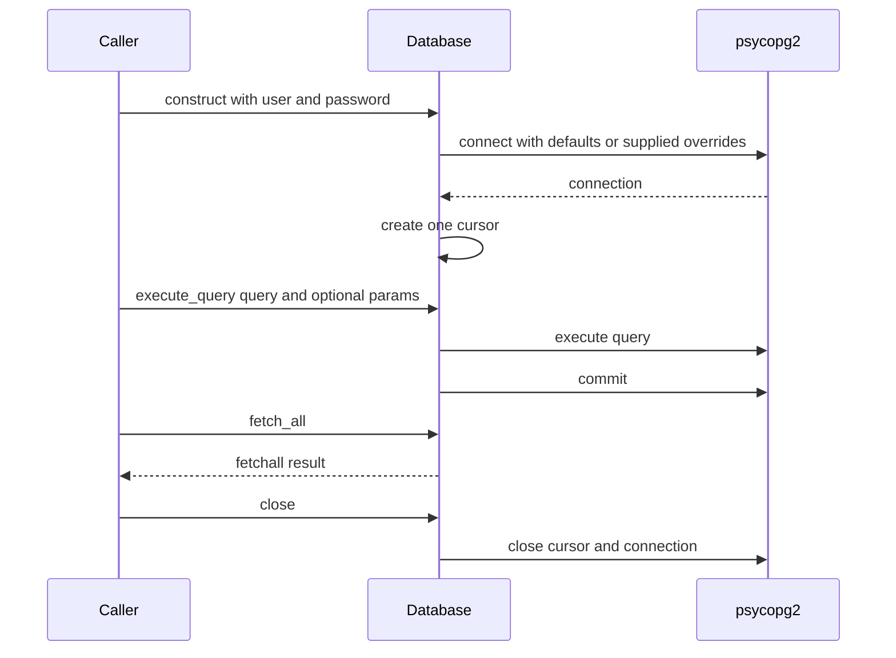

# PostgreSQL Integration and Persistence

## Integration boundary

`src/database.py` defines the repository's `Database` wrapper, but it is not used by the active application path: `src/app.py` starts `StockSimulator` from `src/login.py`, whose login handler only prints the entered credentials and contains a comment that login logic remains to be added. The wrapper has no repository callers. By contrast, the root-level `doc1.py`, `doc2.py`, and `doc3.py` prototype scripts import and call `psycopg2` directly. Treat their SQL as evidence of historical/prototype behavior, not as a contract implemented by `Database` or proof that the current application persists data.

See [Architecture and ownership](../architecture/ownership.md) for the application boundary, and the related [local runtime](../operations/local-runtime.md), [auth and secrets](../security/auth-and-secrets.md), [current login](../workflows/current-login.md), and [prototype trading](../workflows/prototype-trading.md) pages for their respective concerns.

## `Database` wrapper contract

The wrapper is deliberately minimal:

| Operation | Implemented behavior |
| --- | --- |
| Construct | Requires `user` and `password`; connects immediately using psycopg2, then creates one cursor. Defaults are `host='127.0.0.1'`, `port='5432'`, and `database='stocksdb2'`. |
| `execute_query(query, params=None)` | Calls `cursor.execute(query, params)` only when `params` is truthy; otherwise calls `cursor.execute(query)`. It then commits the connection for every successful execution, including a read query. It returns no result. |
| `fetch_all()` | Returns `cursor.fetchall()` from the cursor's current result set. It does not execute another query or commit. |
| `close()` | Closes the cursor, then the connection. |

There is no configuration-file or environment-variable lookup in the wrapper. It does not expose rollback, transaction scoping, pooling, context-manager behavior, retry logic, or exception translation. psycopg2 connection/execute/fetch/close errors are not caught here and therefore surface to the caller. A failure during execution prevents the subsequent commit; the wrapper has no explicit rollback path. Callers must manage errors and ensure closure themselves. Also note that an empty parameter sequence is falsey and follows the no-parameters branch.

This sequence shows the wrapper's explicit connection, execution, fetch, and shutdown calls; it does not imply that any current application caller uses the wrapper.

## Direct psycopg2 use in prototypes

The prototypes open connections themselves, commonly with the same loopback host, PostgreSQL port, and `stocksdb2` database, and create and close cursors locally. Login-like flows use submitted email and password values as the PostgreSQL username and password, then issue `select * from account` and take the first returned row's first value as a demat number (`doc2.py`, `doc3.py`). This is a database-role connection attempt, not an application-layer password check. `src/login.py` currently does not perform this flow.

`doc3.py` also contains a prototype account-creation path using a hard-coded PostgreSQL administrator connection. It selects existing `demat_no` values, sorts them, takes the largest value and increments it, then inserts an `account` row and a `client` row. It next creates a PostgreSQL user whose identifier is the submitted email and whose password is the submitted password, then grants the existing role `clients` to that user. The role creation statement uses `psycopg2.sql.Identifier` and `sql.Literal`; nearby account/client inserts and the grant use interpolated SQL strings. Each of these statements is committed separately, and no code here provisions the `clients` role. Thus failures can leave partially applied account/role setup, and the required administrator login and role setup are external prerequisites, not configuration provided by this repository. The prototype catches database exceptions and displays them, but its `finally` path displays a success message and returns to login after the cleanup block when execution reaches it, even if an earlier account-creation statement failed.

The prototypes additionally use a hard-coded administrator credential in some paths for reads and writes, while other operations connect as the submitted user. Do not treat these prototype credentials or privilege choices as a deployment recommendation; no secret-management/configuration mechanism is supplied here.

## Tables referenced by prototype SQL

The table names below describe SQL references in the prototypes only. Their names and selected/inserted columns do **not** establish actual PostgreSQL schema, constraints, keys, or relationships.

| Table name | Observed prototype use |
| --- | --- |
| `account` | Read after user login; inserts an initial account record during account creation; reads and updates balance and account totals in trading code. |
| `client` | Receives profile and demat-number values during prototype account creation. |
| `shares` | Listed and read for quote/quantity values; trading code updates its quantity. |
| `a_shares` | Queried for holdings; receives purchase rows; read and updated/deleted during sell handling. |
| `transactions` | Listed and queried for transaction ids; receives buy/sell records and is used in aggregate queries. |
| `company` | Listed and queried for company/market-cap information. |
| `events` | Queried by a prototype UI action. |

A trade is not one database transaction in the prototype: inserts and subsequent updates are performed by separate helper calls that each open a connection and commit independently. There is no cross-step atomicity or rollback if a later operation fails. Transaction ids are derived by selecting existing ids and incrementing the last value in application code, rather than using a repository-defined sequence. These are behavioral facts about the scripts, not recommended persistence guarantees.

## Schema, migrations, and verification gaps

No SQL schema definition, migration, or seed-data files are present in the inspected repository; no focused database tests are present either. `src/README.md` describes the source layout and dependencies but provides no database bootstrap instructions. The prototype statements are insufficient to infer table definitions or safely create a compatible database. In particular, verify the columns and types, constraints/indexes, ownership and grants for `clients`, transaction-id generation, and expected row cardinality against the actual database before operating or changing these scripts. `stocksdb2`, the local host/port, and the role behavior are code defaults/assumptions, not evidence that a PostgreSQL instance or matching schema is installed.

For current authentication behavior, consult [Current login](../workflows/current-login.md); for prototype trade flows, see [Prototype trading](../workflows/prototype-trading.md).
