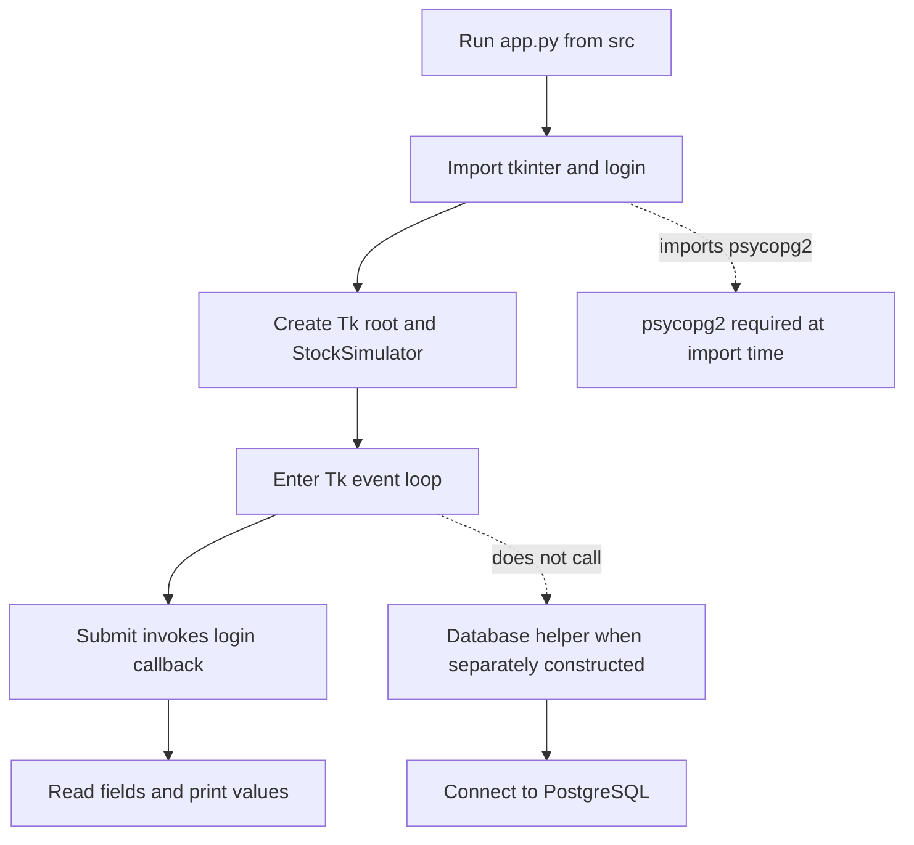

# Local Runtime, Configuration, and Failure Triage

## Supported local launch

The source README lists Python 3, `psycopg2`, and `tkinter` as requirements and says to run `app.py`. Because [src/app.py](../../src/app.py) imports `login` as a top-level module, run it with `src/` as the working directory, for example:

```sh
cd src
python app.py
```

The launcher creates a Tk root window, instantiates `StockSimulator` from `login.py`, and enters Tk's event loop. The UI's submit callback reads the email and password fields and prints them; it does not authenticate or connect to the database. `login.py` imports `psycopg2` at module load nonetheless, so that package is needed to import and launch this UI path even though the active callback does not use it.



*This shows the active UI startup and submit path, and the separate database helper boundary; the UI does not use the helper.*

See [System Architecture and Ownership](../architecture/ownership.md) for module boundaries and [PostgreSQL Integration and Persistence](../integrations/postgresql.md) for the helper's detailed contract and prototype SQL context.

## Runtime and database configuration

There is no runtime configuration mechanism documented or implemented for the active launch path: the inspected source contains no environment-variable lookup, and the source README provides no configuration-file or bootstrap instructions. `src/database.py` requires `user` and `password` arguments when a caller constructs `Database`, with these literal connection defaults:

| Setting | Default or source |
| --- | --- |
| PostgreSQL host | `127.0.0.1` |
| PostgreSQL port | `5432` |
| Database name | `stocksdb2` |
| PostgreSQL user and password | Required constructor arguments; no values are supplied by the helper |
| Python dependencies | README lists Python 3, `psycopg2`, and `tkinter`; no versions or install manifest are specified |

These database defaults do not configure or validate a PostgreSQL installation, and they are not requirements for the active UI's submit flow. Do not use credentials found in the independent root-level prototype scripts as setup instructions; no supported secret provisioner or runtime credential configuration is evidenced here. For the database helper, construction connects immediately, and a connection failure propagates to the caller.

## Failure triage

| Symptom | Likely owner and interpretation |
| --- | --- |
| `ModuleNotFoundError` for `login` when launching | [src/app.py](../../src/app.py) imports `login` by module name. Launch with `src/` on Python's import path; the documented layout is to run `app.py` from `src/`. |
| Import error for `psycopg2` before the window opens | [src/login.py](../../src/login.py) imports `psycopg2` at module load. It is an import-time dependency despite not being used by the active callback. Dependency versions and an install command are not specified. |
| Tk initialization or window-display failure | The active UI is owned by [src/app.py](../../src/app.py) and [src/login.py](../../src/login.py), both of which create a Tk window. The repository does not document headless operation, display setup, or a fallback mode. |
| PostgreSQL connection failure from a consumer of `Database` | [src/database.py](../../src/database.py) connects in `Database.__init__` using supplied credentials and the host, port, and database defaults above. Driver connection exceptions are not caught there. The active `app.py`/`login.py` path does not construct `Database`, so this is not a cause of its normal login-screen startup. |
| SQL execution, commit, fetch, or close failure | The owning helper is [src/database.py](../../src/database.py). It does not translate or catch driver exceptions, retry, or provide an explicit rollback path. Inspect the calling code and PostgreSQL state; there is no repository health check or diagnostic procedure to run. |
| Submit appears not to log in | [src/login.py](../../src/login.py) currently only reads the fields and prints their values; the comment marks login logic as not implemented. This is not evidence of a PostgreSQL outage. |

The source provides no structured logging, error codes, retry policy, or UI error presentation for these failures. Focused runtime or database test procedures are also not supplied in the inspected source; there are no test files in `src/`.

## Operational limits and verification gaps

The repository does not represent a deployment shape, service process model, health checks, runtime configuration interface, database provisioning or schema bootstrap, or operational runbook. The local Tkinter launch instruction is not a deployment procedure. The source README does not specify dependency versions, installation steps, or tests, and this page does not infer them. See [PostgreSQL Integration and Persistence](../integrations/postgresql.md) for the separate schema and migration gap.
