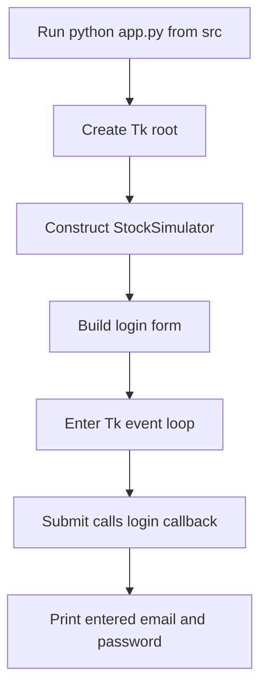

# Agent Quickstart

## Start the active application

From the repository root, run:

```sh
cd src
python app.py
```

This is the active Tkinter entrypoint: `app.py` creates the root window, constructs `StockSimulator`, and starts Tkinter's event loop ([`src/app.py`](../src/app.py#L1-L7)). The source README identifies Python 3.x, Tkinter, and `psycopg2` as requirements and says to run `app.py` ([`src/README.md`](../src/README.md#L12-L18)). The login module imports `psycopg2`, so it must be importable even though this UI path does not open a database connection ([`src/login.py`](../src/login.py#L1-L3), [`src/login.py`](../src/login.py#L26-L35)). A working local Tk display is also needed to show the window.



The diagram shows the active UI startup and submit path; the callback currently prints the entered values rather than authenticating or querying PostgreSQL ([`src/app.py`](../src/app.py#L4-L7), [`src/login.py`](../src/login.py#L12-L30)).

> **Important:** The visible login form is not an implemented authentication boundary. Its Submit callback prints the email and password to stdout. Do not use real credentials with it; see [Authentication, Sensitive Data, and Trust Boundaries](security/auth-and-secrets.md).

## Route by task or symptom

| If you are investigating… | Start here |
| --- | --- |
| Which modules own active app behavior, and how that differs from root-level scripts | [System Architecture and Ownership](architecture/ownership.md) |
| Tkinter startup, login form, or Submit behavior | [Current Application Startup and Login UI](workflows/current-login.md) |
| Account, holdings, buy, or sell logic in standalone scripts | [Standalone Trading and Account Prototypes](workflows/prototype-trading.md) |
| PostgreSQL connection behavior, wrapper semantics, or prototype queries | [PostgreSQL Integration and Persistence](integrations/postgresql.md) |
| Credentials, authentication gaps, or sensitive data handling | [Authentication, Sensitive Data, and Trust Boundaries](security/auth-and-secrets.md) |
| Local dependencies, startup failures, or runtime triage | [Local Runtime, Configuration, and Failure Triage](operations/local-runtime.md) |
| How to validate a change and what test coverage exists | [Testing and Change Validation](testing/validation.md) |

The current `src/app.py` → `StockSimulator` path is separate from the root-level prototype programs; for example, `doc1.py` creates its own Tk root and imports PostgreSQL directly ([`src/app.py`](../src/app.py#L1-L7), [`doc1.py`](../doc1.py#L1-L5)). Treat the prototype workflow and its persistence behavior as a separate concern, not as functionality reached through the active login screen.
