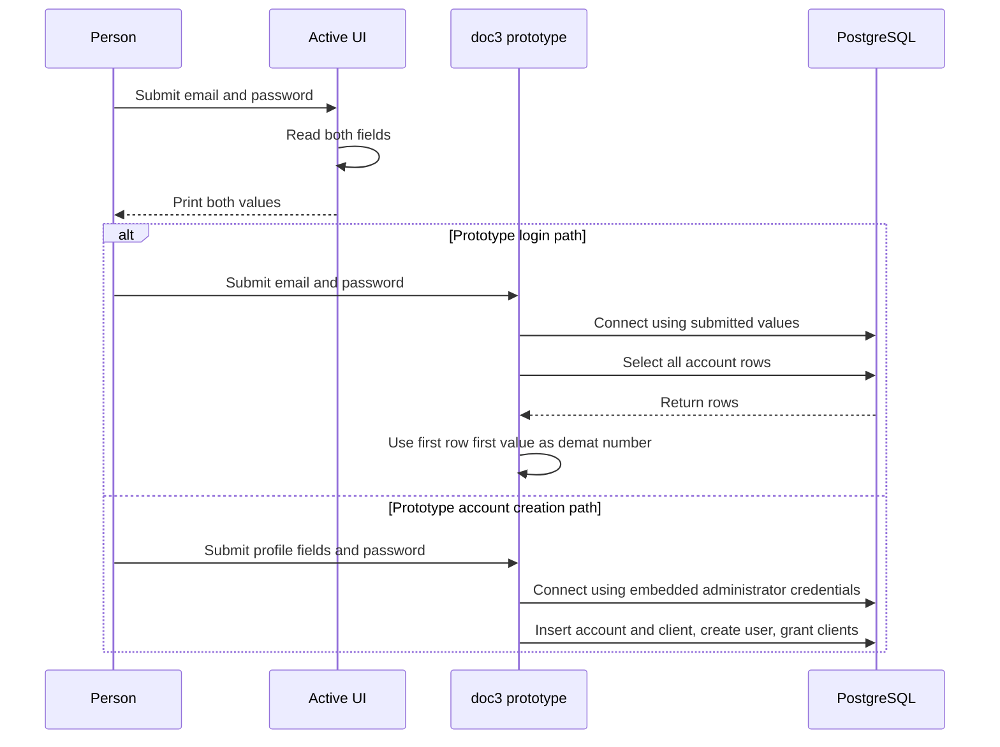

# Authentication, Sensitive Data, and Trust Boundaries

## Two different login paths

The runnable UI is `src/app.py` → `StockSimulator` in `src/login.py`. Its submit handler reads the email and password fields and prints both values; it contains only a comment where login logic should go. The password widget masks characters on screen, but that does not protect the value from the callback's console output. This path does not connect to PostgreSQL, validate credentials, establish an authenticated session, or authorize an action. Although `src/login.py` imports `psycopg2`, the active callback does not use it. See [Current login](../workflows/current-login.md) and [Local runtime](../operations/local-runtime.md).

Root-level `doc2.py` and `doc3.py` are separate database-using prototypes, not implementations behind the active UI. Their login callbacks pass the submitted email and password as PostgreSQL `user` and `password`, connect to the local `stocksdb2` database, run `select * from account`, and use the first result row's first value as a demat number. This is PostgreSQL role authentication, not a separate application password check. The query is not filtered to a client identity, and the prototype does not show a corresponding identity-to-row check. Do not infer that a successful connection establishes tenant isolation or that the first row belongs to the connecting user. Later prototype database operations continue to carry the submitted credentials; actual access is determined by database privileges, whose full definitions are not in the repository. See [PostgreSQL integration](../integrations/postgresql.md) and [Prototype trading](../workflows/prototype-trading.md).

*This contrasts the active UI's print-only callback with the two separate database-backed prototype flows; it does not imply that either prototype runs through the current launcher.*

## Prototype account provisioning and role boundary

`doc3.py`'s account-creation handler connects with a source-embedded administrator credential, reads all existing demat numbers, sorts them, and chooses the last value plus one. It inserts an initial `account` row and then a `client` row, creates a PostgreSQL user using the submitted email as the role name and the submitted password as its password, and grants that user the pre-existing `clients` role. The operations are committed one at a time, so a later failure can leave earlier rows or role setup behind. The source does not provision the `clients` role or define its grants; those are external database prerequisites. Its exception path reports failure, but the `finally` block also displays a success message and returns to login, so that message is not proof that provisioning succeeded.

A PostgreSQL role is a database identity/privilege boundary, not by itself an application authorization policy. The prototype's UI reveals some analytics buttons based on an email allow-list, but hiding or showing controls is not a database permission check. Verify actual ownership, grants, and any row-level policies against the deployed database; this repository supplies no complete role definition or demonstrated per-client row restriction. Before changing provisioning, define explicitly which identity owns account creation, what the `clients` role can read or mutate, and how every query is constrained to the intended client. Do not give client roles administrator powers or trust a UI-only check as authorization.

## Credential and personal-data exposure

Treat the prototypes as unsafe examples, not as credential-management patterns:

- Administrator connection credentials are embedded in prototype source, including code paths that execute and older commented snippets. Do not copy those values into documentation or configuration. Remove them from code, provision secrets outside the repository, and rotate any credential that was exposed in source history.
- The active UI prints the submitted password. In `doc3.py`, the account form accepts a password in an unmasked entry, provisioning prints the rendered `CREATE user` statement (which contains the password literal), and the trading path prints the carried account and password. These paths can disclose credentials to terminal output or logs.
- Account creation accepts a person's name, PAN, age, and email and inserts those fields into `client`. The prototype also contains personal identifiers in comments and has specific email values in a UI allow-list. Do not reproduce those values in docs, logs, screenshots, or test fixtures; remove unnecessary examples from source and handle the fields as sensitive personal data.
- Prototype database errors are printed, and some are also shown in a dialog. Avoid returning raw database exceptions to end users: errors can disclose implementation or database details. The repository does not show a secret store, redaction layer, password hashing, transport policy, or dedicated audit/logging controls. Do not assume any of those protections exist.

The active UI's masked password entry is only a display choice, not a security control. Likewise, PostgreSQL's password handling is not evidence that the application itself hashes or safely stores a password; this code submits the password as a database role password and exposes it through output.

## SQL inputs and safe changes

The repository shows both useful safe patterns and unsafe construction patterns. `src/database.py` can pass a parameter sequence to `cursor.execute(query, params)`, and prototype inserts use `%s` placeholders for row values. Prefer bound parameters for all data values: profile fields, quantities, prices, and stock symbols. Do not interpolate form values into SQL with f-strings or concatenate them into a query. Prototype client inserts, balance and quantity updates, and some stock-specific queries interpolate user-provided values directly. The grant statement also inserts the submitted role name into SQL text.

SQL values and SQL structure are different: placeholders bind values, not table, column, or role identifiers. For dynamic identifiers, use `psycopg2.sql.Identifier` and an explicit allow-list; retain fixed query templates and validate numeric inputs before use. `doc3.py` uses `sql.Identifier` for the role name and `sql.Literal` for the password in `CREATE user`, but then prints the rendered statement, leaking that secret; safe quoting does not make logging a secret safe. The later interpolated grant should also be built with identifier-safe composition rather than string formatting.

The `Database.execute_query` wrapper is currently uncalled by the active app and commits each successful execution; using it does not automatically make a multi-step account or trade workflow atomic. For a security-sensitive change, review parameterization, the actual PostgreSQL role grants, transaction boundaries and rollback behavior together. In particular, account creation and prototype trades commit multiple steps independently, so partial state is possible. The [PostgreSQL integration](../integrations/postgresql.md) page describes the wrapper and prototype persistence limits in more detail.

## Focused verification when changing this area

There is no implemented authentication flow in the active UI to regression-test yet. When adding one, test that credentials never appear in console output or user-facing errors, failed authentication does not enter the authenticated UI, and access decisions are enforced by the server/database rather than button visibility. For prototype or replacement account provisioning, test duplicate/invalid identifiers, failed steps and rollback, least-privilege role grants, and the relationship between an authenticated role and the account rows it may access. For SQL changes, test unusual quotes and other hostile input as data, and verify that it cannot change query structure. Use synthetic personal data and credentials only.
