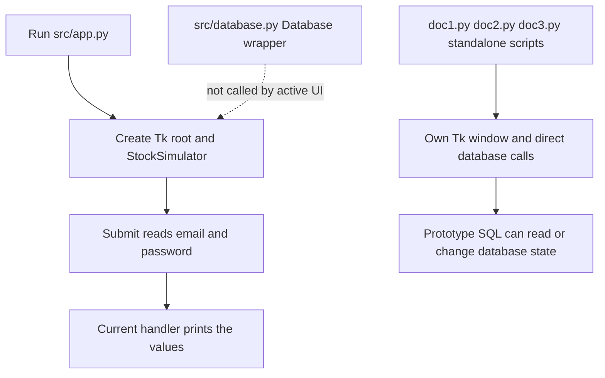

# Testing and Change Validation

## Coverage status

The repository contains no checked-in automated test files or test-runner configuration. The [source README](../../src/README.md) lists Python, `psycopg2`, and `tkinter` as requirements and says to run `app.py`; it does not define a test command, fixtures, or a test suite. No test coverage should therefore be inferred from these files or from the prototype scripts. The validation ideas below are recommendations, not tests that currently exist.

The code has three different validation surfaces. The active Tkinter screen, the unused PostgreSQL helper, and the root-level scripts do not form one application flow; validate the boundary you changed rather than treating a successful GUI launch as evidence of database or trading behavior.

*The diagram separates the active UI path from the independent database helper and database-using prototypes; it is not a test-coverage diagram.*

## Safe baseline checks

- For syntax-only feedback without starting a window, opening a database connection, or executing top-level script code, run `python -m py_compile src/app.py src/login.py src/database.py doc1.py doc2.py doc3.py` from the repository root. This checks that the files compile, not that imports, UI callbacks, SQL, or runtime behavior work.
- To smoke-check the documented active launch path, run `python app.py` from `src/` in an environment with a graphical display and the declared dependencies installed. The login callback currently prints both submitted values; use dummy values, never real credentials, for this check. A window opening and a submit callback firing validate only that narrow UI path.
- Do not use the default local database or any account-bearing database as a test fixture. Prototype trade and account-creation paths issue persistent SQL. Use a disposable PostgreSQL instance/database and test-only roles/data for any integration experiment, and verify the target connection and reset procedure before running a mutation.

## Validation by boundary

| Boundary | What source currently does | Focused validation to add or perform |
| --- | --- | --- |
| Tkinter app | `src/app.py` creates the root, constructs `StockSimulator`, and enters `mainloop`. `src/login.py` builds a login form; `login()` reads its fields and prints them. It does not authenticate or call PostgreSQL. | In a display-capable environment, smoke-check window creation and submission with dummy entries. For isolated callback/UI tests, use a test-owned Tk root or replace/mock the UI boundary; do not assert database behavior from this path. There are no such tests in the repository. |
| `Database` wrapper | `src/database.py` connects in its constructor, stores one cursor, executes and commits in `execute_query`, fetches the current cursor result in `fetch_all`, and closes cursor then connection in `close`. No active app module calls it. | Unit-level checks can replace or mock `psycopg2.connect` and its cursor to verify connection arguments, execution with and without truthy `params`, commit timing, fetch results, and close behavior without a server. If checking PostgreSQL compatibility end to end, use a disposable database with a schema you explicitly create and own; the repository supplies no schema fixture. |
| `doc1.py`, `doc2.py`, `doc3.py` prototypes | Each is a separate Tkinter script with top-level GUI startup and direct `psycopg2` calls. The larger prototypes include account and trade operations; multi-step operations issue separate helper calls and commits rather than one atomic transaction. | Treat these as manual/integration checks only after setting up disposable data and roles. Check expected rows and balances before and after, then discard or reset the database. Do not run prototype buys, sells, account setup, balance changes, or other mutations against a live account database. |

The wrapper's `params` branch is selected only when `params` is truthy, and it commits after every successful `execute_query` call. A focused wrapper check should include an empty parameter sequence as well as populated parameters, and should distinguish a failed execution (which does not reach the subsequent commit) from a successful one. The wrapper does not provide rollback or managed cleanup on failure, so tests should assert observed behavior rather than assume transaction management. See [PostgreSQL integration](../integrations/postgresql.md) for its complete contract and limitations.

## Prototype isolation and failure boundaries

The prototypes are especially poor candidates for casual smoke testing against a developer's ordinary database: they connect directly from UI callbacks, and writes are split across statements/connections with commits. A later failure can leave partial state. Their database defaults and role assumptions are not proof that a safe local fixture exists. The repository does not include schema creation, migrations, or seed data, so first verify the schema and role setup independently; do not infer a compatible database from the scripts' table names.

Keep manual prototype checks narrow: select/read-only paths can validate a disposable fixture's connectivity and display, while mutation paths need explicit before/after checks and a reset or throwaway database. Because these scripts create Tk windows and enter event loops at module top level, importing or executing them is not a side-effect-free unit-test setup. Isolate database effects and avoid importing them just to inspect functions.

For responsibilities and wiring, see [System Architecture and Ownership](../architecture/ownership.md). For current login behavior and PostgreSQL assumptions, see [PostgreSQL Integration and Persistence](../integrations/postgresql.md).
