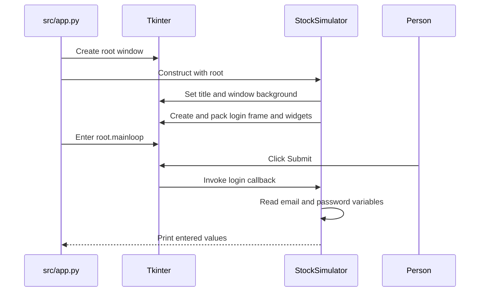

# Current Application Startup and Login UI

## Active startup and ownership

The checked-in launcher is [`src/app.py`](../../src/app.py). When run as the main script, it creates a Tkinter root window, constructs `StockSimulator` from [`src/login.py`](../../src/login.py) with that root, and enters `root.mainloop()`. The root owns the window/event loop; `StockSimulator` builds the visible login form and its callback. The loop dispatches UI events, including Submit, to the callback.

*This sequence shows only the inspected active launcher, UI-construction, and submit-callback path.*

The launcher imports `StockSimulator` before creating the root. `login.py` imports `psycopg2` at module load, so that Python dependency is required to import the UI module even though the active UI never opens a database connection. `app.py` has no startup exception handling; import, Tk initialization, or UI-construction failures are not caught there. The project README describes running `app.py` from the `src/` directory. `login.py` also contains a main guard that independently creates a root, constructs the same class, and enters the event loop when that file is run directly; this does not introduce a different login implementation.

## UI construction and input state

`StockSimulator.__init__` keeps the supplied root on the instance, sets the title to `Stock Simulator Login` and the window background to black, then calls `create_login_frame()`. That method creates and packs a `LabelFrame` and lays out email and password labels and `Entry` widgets. The input widgets are connected to instance-owned Tkinter `StringVar` values (`email_var` and `password_var`); the password entry uses `show='*'` to mask characters in the UI. The Submit button is wired directly to `self.login` through its `command` option.

The form is only a presentation and input surface. The callback reads the current values from the two variables when invoked; the source does not add input validation, clear the fields, change screens, or establish a session after submission. Masking the password in the entry affects its display, not what the callback can read or print.

## Submit behavior and integration boundary

`login()` gets both field values and prints a formatted `Logging in with ...` line containing the entered email and password. **As implemented, submitting the form prints the entered credentials to standard output.** Do not use real credentials when manually exercising this callback, and do not copy submitted values into documentation, tests, or logs.

Despite the login-oriented window and callback names, there is no credential verification, authentication/session state, authorization decision, or transition to another screen in this path. `login.py` imports `psycopg2`, but does not call it in the callback. The separate [`Database` helper](../../src/database.py) is not imported or invoked by `app.py` or `login.py`; submitting the form therefore does not connect to PostgreSQL, query a database, or persist the entered values. The import itself may still fail if `psycopg2` is unavailable, before the window starts. For the helper's independent connection behavior, see [PostgreSQL Integration and Persistence](../integrations/postgresql.md).

This distinction is important when changing the login flow: wiring or changing `src/database.py` alone does not make the current UI authenticate. An implementation that adds authentication must deliberately connect the UI event to a verification boundary and define success, failure, session, and credential-handling behavior. The existing behavior and module ownership are also summarized in [System Architecture and Ownership](../architecture/ownership.md), and security implications are covered in [Authentication, Sensitive Data, and Trust Boundaries](../security/auth-and-secrets.md).

## Verification

The repository's [Testing and Change Validation](../testing/validation.md) page records that no automated test suite is checked in and distinguishes UI checks from database-helper checks. For this path, a focused manual smoke check in a display-capable environment is to launch `app.py` from `src/`, confirm the login window appears, and submit synthetic values only. Since the callback prints both inputs, capture or inspect output only with dummy data. A targeted callback test can supply test-owned/fake variable objects and capture standard output without opening a database; it should characterize the current print behavior rather than imply authentication exists. Tests for any future authentication should verify that secret values are not printed and that authentication failure cannot proceed as success.

The README's launch guidance is in [`src/README.md`](../../src/README.md); see [Quickstart](../quickstart.md) for the wider repository's run instructions.
