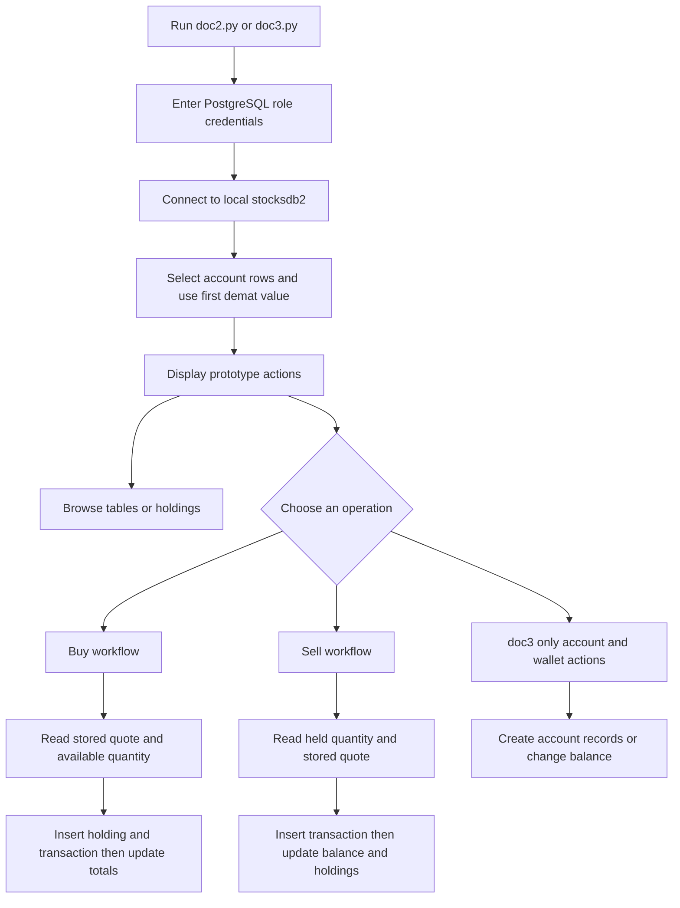

# Standalone Trading and Account Prototypes

## Scope and active-application boundary

`doc1.py`, `doc2.py`, and `doc3.py` are standalone Tkinter scripts, not modules called by the active application. Each script creates its own window and event loop and uses direct `psycopg2` connections. `doc1.py` is primarily a table-browsing prototype; `doc2.py` adds account/holdings views and buy/sell workflows; `doc3.py` is a divergent expanded version with account creation and wallet controls as well. The active `src/app.py` only starts `StockSimulator` from `src/login.py`; its submit callback prints the submitted values and does not call these scripts or connect to PostgreSQL. See [System Architecture and Ownership](../architecture/ownership.md) for the fuller application boundary.

*This diagram summarizes the root scripts' database-backed prototype paths; the separate steps do not share one atomic trade transaction.*

## Entrypoints, login, and browsing

All three scripts initialize Tkinter at module top level, so running or importing them is not a side-effect-free way to access their functions. `doc1.py` asks for email and password and uses those values as the PostgreSQL username/password when a table-view action runs. Its menu queries `transactions`, `a_shares`, and `company`. `doc2.py` and `doc3.py` use a login submit callback: connect to the local `stocksdb2` database with the entered values, run `select * from account`, and take the first row's first value as the demat number passed to the home screen. This is PostgreSQL role authentication, not an application-level password check or proof that the selected account row belongs to that role. The prototype screens expose table views for account/transaction/company/share/event data and a holdings view.

The holdings action joins `a_shares` to `shares` by stock symbol, totals `number_of_shares`, and displays the stored `share_price` as LTP. In both larger scripts, `afterlogin` has special handling for the `a_shares` display: it aggregates transaction prices by stock, appends a derived average and per-row profit to the displayed results, totals that computed value, and writes it to `account.profit`. Thus a screen action labeled as a holdings view also performs a database update. The calculation/query differs slightly between variants: `doc2.py` divides by the transaction aggregate as written, while `doc3.py` adds a small constant to its denominator; their per-row profit subtraction order is also reversed. These are prototype calculations, not a demonstrated portfolio accounting invariant.

`doc2.py` and `doc3.py` contain a commented-out `pynse` quote-refresh sketch. It is not an active quote update path: the trading UI reads the current price and available quantity from the PostgreSQL `shares` table.

## Account creation and wallet controls in `doc3.py`

Only `doc3.py` includes a create-account form. Its handler connects using an embedded administrator credential, reads and sorts existing demat numbers, takes the largest and adds one, then inserts an `account` row initialized with zero totals and a `client` row containing the submitted profile fields. It next creates a PostgreSQL user named from the submitted email, grants that user the pre-existing `clients` role, and commits each operation separately. The create-user statement uses `psycopg2.sql.Identifier` and `sql.Literal`, but nearby account/client inserts and the later grant statement are assembled with string interpolation. A failure after an earlier commit can leave a partial account or role setup; concurrent account creation can also race on the max-plus-one identifier. The `finally` block displays a success dialog and returns to login even if an earlier operation raised an exception, so that dialog does not prove provisioning succeeded. The script does not create or define the `clients` role. For security and role-boundary concerns, see [Authentication, Sensitive Data, and Trust Boundaries](../security/auth-and-secrets.md).

The `doc3.py` home screen also offers add-to-wallet and withdraw-from-wallet actions. `updatebalance` adds or subtracts the entered amount from `account.balance` and commits the update. It interpolates the amount into SQL, performs no evident positivity or withdrawal-availability check, and has no `WHERE` clause. Do not assume the update is confined to one account row; actual cardinality and database permissions depend on the external schema and grants.

## Buy workflow

The buy screen in `doc2.py` and `doc3.py` offers a fixed list of symbols and a quantity field. On confirmation, `purchaseorder`:

1. Reads `shares` through an administrator connection and obtains the stored price and available quantity for the selected symbol.
2. Rejects a quantity greater than the available quantity, computes price multiplied by quantity, then reads `account.balance` using the submitted PostgreSQL role and rejects an amount greater than that balance.
3. Inserts a purchase row into `a_shares` and a buy row into `transactions` (`sell_buy` is `1`). These inserts use `%s` parameters, but the helper runs them through an embedded administrator connection.
4. Runs separate updates to decrement `shares.quantity`, increase `account.invested` and `account.currentval`, and decrease `account.balance`.

The code does not establish a comprehensive order-validation policy: for example, it does not visibly enforce a strictly positive quantity or re-check stock and balance under a lock at update time. Each subsequent update is independently committed, so passed checks do not guarantee that all the writes complete together. Account total updates have no account-row filter in the SQL shown; do not infer a single-row or per-client invariant from the UI.

## Sell workflow and variant difference

The sell screen populates its choices from distinct symbols in `a_shares`. `sellorder` sums held quantities by symbol and rejects a requested amount greater than the sum, looks up the stored `shares` price, computes sale proceeds, and creates a transaction with `sell_buy` set to `-1`. The scripts then increase `shares.quantity`, credit `account.balance`, and reduce `account.currentval`; the contemplated change to `account.invested` is commented out.

A material difference is how the prototypes update the holdings ledger. `doc2.py` does not decrement or delete rows in `a_shares` during its sell path, so its sell transaction and balance/market updates can disagree with the holdings rows used for subsequent sell choices. `doc3.py` additionally decrements `a_shares.number_of_shares` for the chosen symbol and deletes rows whose quantity reaches zero. Its holdings update filters only by symbol, not by demat number, and its cleanup can delete zero-quantity rows across the table; both use the embedded administrator connection. Neither script wraps the sale, transaction insert, balance change, market quantity change, and holdings adjustment in one transaction.

## Persistence, safety, and failure boundaries

The table names and columns above are only what the scripts' SQL references; they do not establish a schema, constraints, keys, or row ownership. Connections target a local PostgreSQL instance and the `stocksdb2` database. The scripts mix user-supplied PostgreSQL-role connections with source-embedded administrator connections. Some inserts use bound parameters, but several account/client inserts, wallet changes, stock-quantity updates, and symbol-specific queries construct SQL with f-strings. This is unsafe SQL construction; values should be parameterized and dynamic identifiers handled separately. The prototypes also print sensitive values or rendered SQL in some paths. No credentials or personal identifiers are reproduced here; do not reuse values embedded in source. More details are in [PostgreSQL Integration and Persistence](../integrations/postgresql.md) and [Authentication, Sensitive Data, and Trust Boundaries](../security/auth-and-secrets.md).

`insertinto` and `updatefun` each open a connection, execute, commit, and close independently. Buy and sell operations therefore consist of multiple commits, with no shared transaction, rollback plan, or compensation if a later write fails. Account creation has the same multi-commit partial-update risk. Database exceptions are printed and generally do not stop all subsequent Python statements, so a success dialog or a printed row count should not be treated as confirmation that the entire operation succeeded. The code also obtains transaction identifiers by reading existing ids and incrementing one in Python rather than relying on a repository-defined sequence; no concurrency guarantee follows from that approach.

The `src` application and its small `Database` helper are separate: the active UI does not invoke either these scripts or the helper. Do not treat the behaviors described here as production trading, financial controls, or transactional guarantees. The proposed checks below are manual validation guidance, not instructions to use an ordinary account database; see [Testing and Change Validation](../testing/validation.md) for broader validation boundaries. For any controlled experiment, use a disposable database with synthetic accounts and data, inspect the exact target and before/after rows, and discard or reset it. Never run mutation paths against a live or valuable account database.

## Focused validation when changing prototypes

Validate the specific path in an isolated environment rather than relying on a successful window launch:

- For read and holdings views, seed a disposable schema with multiple account and holdings rows; check which rows the unfiltered queries return and verify that the holdings view's calculation and `account.profit` write behave as expected for buys, sells, and zero-net transaction quantities.
- For account creation, simulate failures after each committed statement and verify the resulting partial rows and PostgreSQL roles. Check duplicate/concurrent demat allocation, role grants, and that failure cannot display a misleading success state.
- For wallet and order paths, test malformed, zero, negative, excessive, and concurrent quantities/amounts. Assert every affected table and account row after each failure point, including `doc2.py`'s unchanged holdings behavior on sell and `doc3.py`'s decrement/delete behavior.
- Test SQL metacharacters as data and verify they cannot alter query structure. Verify successful operations are scoped to the intended account and that failed operations roll back or otherwise recover consistently before changing any prototype behavior.

These are proposed checks, not tests already present in the repository. The scripts execute GUI setup at import time and have persistent SQL side effects, so isolate database access and avoid importing them in an ordinary unit-test process.

## Source references

- [doc1.py](../../doc1.py)
- [doc2.py](../../doc2.py)
- [doc3.py](../../doc3.py)
- [src/app.py](../../src/app.py) and [src/login.py](../../src/login.py)
